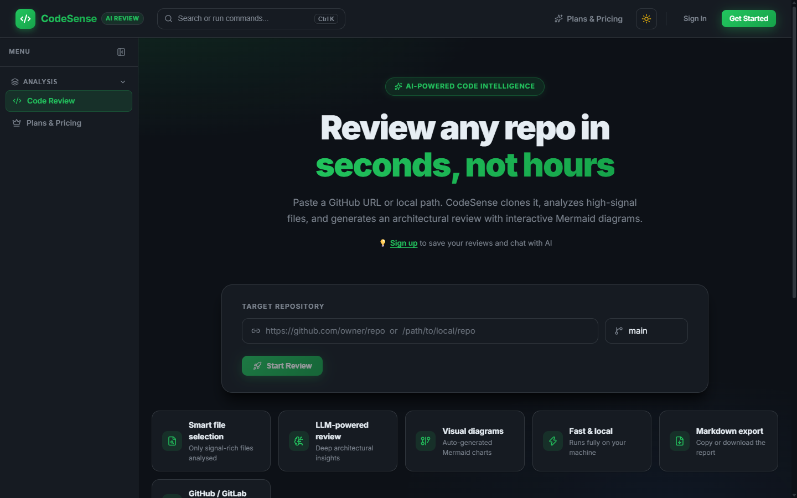
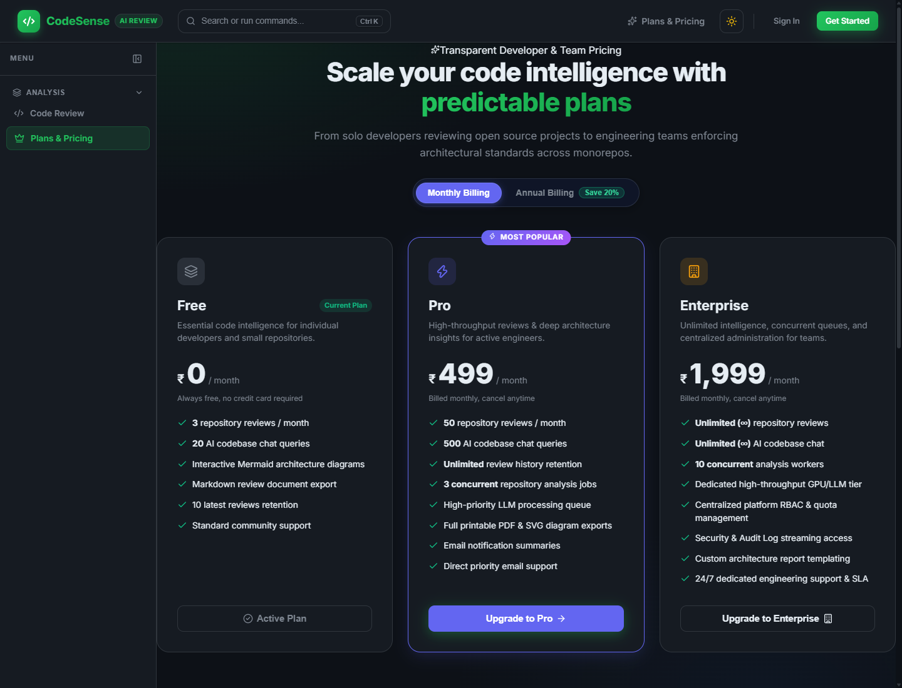
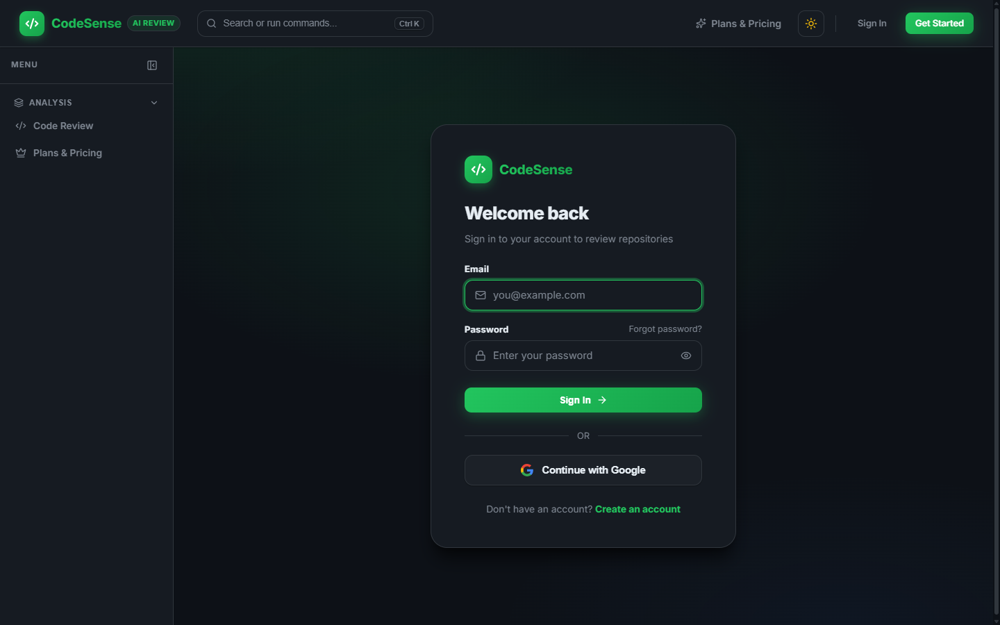
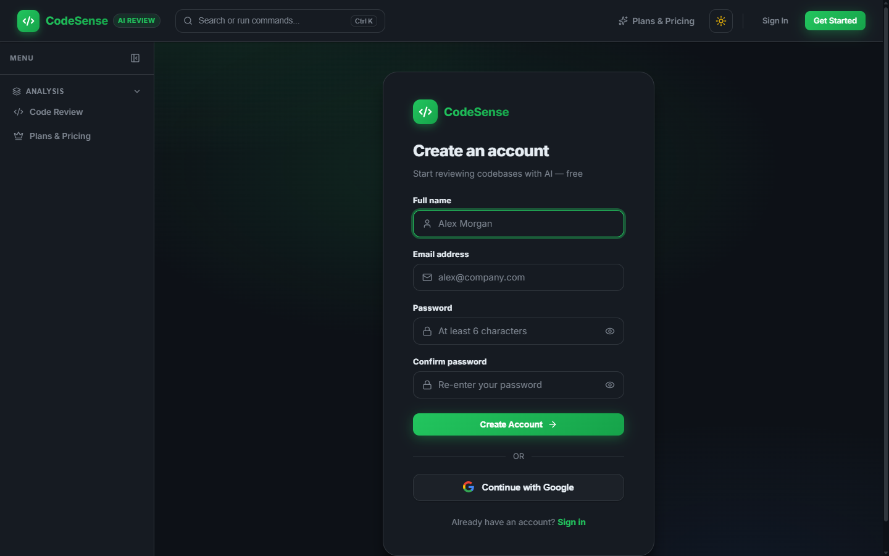

# CodeSense

> **AI-Powered Code Review & Technical Documentation Platform**

CodeSense is an enterprise-grade, student-developed software analysis platform that automates full-codebase code reviews, architectural documentation generation, security auditing, and code exploration. Built with a modern React frontend, a resilient Node.js API gateway, and a specialized Python AI engine powered by RAG (Retrieval-Augmented Generation) and local or cloud LLMs.

---

## 📌 Table of Contents

- [Overview & About](#-overview)
- [Application Screenshots & UI Tour](#-application-screenshots--ui-tour)
- [Key Features](#-key-features)
- [Architecture & System Design](#️-architecture--system-design)
- [Technology Stack](#-technology-stack)
- [Project Structure](#-project-structure)
- [Installation & Setup](#-installation--setup)
- [Configuration](#-configuration)
- [Running the Application](#-running-the-application)
- [Usage Workflow](#-usage-workflow)
- [API Reference](#-api-reference)
- [Future Improvements](#-future-improvements)
- [License & Attribution](#-license--attribution)

---

## 📖 Overview

Modern software development often suffers from incomplete documentation, delayed code reviews, and hidden security vulnerabilities. **CodeSense** addresses these challenges by scanning entire repositories (or local directories) and generating comprehensive, production-ready technical reports spanning:

1. **Executive Summaries & Architectural Maps**: Visualizing data flows, module hierarchies, and system boundaries with automated Mermaid.js diagrams.
2. **Deep Security & Bug Detection**: Pinpointing vulnerabilities, unhandled edge cases, authentication flaws, and OWASP Top 10 risks with file paths and line ranges.
3. **Complexity & Quality Benchmarks**: Calculating cyclomatic complexity heuristics, maintainability scores, and test coverage indicators.
4. **Interactive RAG AI Assistant**: An integrated conversational interface backed by ChromaDB vector embeddings that answers natural-language questions about reviewed codebases with source-cited precision.

---

## 📸 Application Screenshots & UI Tour

### 1. Interactive Repository Review & Architecture Dashboard
> *Enter any GitHub repository URL or local workspace path. CodeSense clones the repo, analyzes high-signal source files, and generates a structured 22-section technical specification document complete with live Mermaid diagrams.*

<p align="center">
  
</p>

### 2. Plans, Pricing & Membership Quotas
> *Tier-based computing allowances (Free, Pro, Enterprise) with instant monthly & annual interval switching, live quota meters, and integrated Cashfree payment checkout.*

<p align="center">
  
</p>

### 3. Developer Authentication & Security
> *Enterprise authentication supporting Google OAuth 2.0 ("Continue with Google") and local bcrypt-encrypted password credentials with JWT session management.*

<p align="center">
  
</p>

### 4. Self-Serve Developer Signup & Verification
> *Clean developer onboarding with 6-digit email OTP verification and strict role-based privilege isolation.*

<p align="center">
  
</p>

---

## ✨ Key Features

- **⚡ Full Codebase Deep Review**: Multi-stage sequential AI generation that analyzes entry points, schemas, controllers, middleware, and dependencies into a 22-section technical specification document.
- **🛡️ Security & Vulnerability Analysis**: Detailed detection of injection risks, hardcoded credentials, authorization bypasses, and sanitization gaps.
- **📊 Code Quality & Complexity Benchmarks**: Automated calculation of file sizes, dependency counts, health scores, and categorized issues (Critical, Major, Minor, Info).
- **💬 Interactive RAG AI Assistant**: Conversational code queries powered by ChromaDB vector similarity search and local Ollama (`qwen2.5:3b`) or cloud LLMs (Gemini, OpenAI, Groq).
- **🎨 Modern Developer UI / UX**: High-contrast, accessibility-focused interface with seamless **Dark (`#0d1117`)** and **Light (`#F6F8FB`)** themes.
- **⌨️ Universal Command Palette (`Ctrl+K`)**: Quick navigation, theme toggling, review triggering, and shortcuts accessible anywhere.
- **📜 Review History & Search**: Persistent MongoDB storage for past review reports with keyword filtering and quick-load capabilities.
- **🔒 Authentication & Role-Based Access**: Secure JWT authentication, bcrypt password hashing, and a dedicated **Admin Dashboard** for system monitoring and user management.
- **📥 One-Click Export**: Download complete architectural documentation and reviews as formatted Markdown files.

---

## 🏗️ Architecture & System Design

CodeSense operates as a decoupled three-tier architecture:

```
┌─────────────────────────────────────────────────────────────┐
│                 CodeSense Frontend (Port 5173)              │
│       React 19 + TypeScript + Vite + Vanilla Design System  │
└──────────────────────────────┬──────────────────────────────┘
                               │ HTTP / REST / JSON
                               ▼
┌─────────────────────────────────────────────────────────────┐
│                 Node.js Gateway (Port 4000)                 │
│      Express-style HTTP Server, JWT Auth & MongoDB Models    │
└──────────────┬──────────────────────────────┬───────────────┘
               │ Async Subprocess             │ HTTP / Proxy
               ▼                              ▼
┌──────────────────────────────┐ ┌────────────────────────────┐
│   Review Generator (Python)  │ │  FastAPI Chat Service      │
│  Sequential Context Packing  │ │  ChromaDB RAG + Vector     │
│  microcore + LLM Orchestrator│ │  Embeddings (Port 8000)    │
└──────────────────────────────┘ └────────────────────────────┘
```

1. **Client Tier**: Vite + React 19 application providing reactive review state, live markdown rendering, Mermaid diagram rendering, and command palette navigation.
2. **API Tier**: Node.js backend managing user authentication, job polling, review history in MongoDB, and request forwarding.
3. **AI Execution Tier**:
   - **Review Engine**: Multi-call Python script using `microcore` that categorizes repository files into high-priority architectures, models, and controllers, generating focused review sections without token overflow.
   - **RAG Engine**: FastAPI microservice on port 8000 indexing review markdown into vector embeddings in ChromaDB to answer follow-up technical queries.

---

## 💻 Technology Stack

### Frontend
- **Framework**: React 19 (TypeScript)
- **Bundler & Dev Server**: Vite
- **Styling**: Vanilla CSS with custom tokens and theme variables (Dark / Light mode)
- **Icons**: Lucide React
- **Diagrams**: Mermaid.js
- **Routing**: React Router DOM v6

### Backend & Database
- **Runtime**: Node.js (v18+)
- **Database**: MongoDB with Mongoose ODM
- **Authentication**: JSON Web Tokens (JWT) + bcryptjs
- **Environment**: dotenv

### AI & Machine Learning Services
- **Framework**: Python 3.10+ (FastAPI + Uvicorn)
- **Vector Database**: ChromaDB (persistent vector storage)
- **LLM Orchestration**: `microcore`
- **Supported Models**:
  - Local: Ollama (`qwen2.5:3b`, `llama3`, `mistral`)
  - Cloud: Google Gemini (`gemini-flash-lite-latest`), OpenAI (`gpt-4o-mini`), Groq (`llama-3.3-70b-versatile`)

---

## 📁 Project Structure

```
codesense/
├── backend/
│   ├── server.js              # Node.js API server & job manager (port 4000)
│   ├── db.js                  # MongoDB connection & Mongoose schemas
│   ├── generate_review_doc.py # Python LLM multi-stage review generator
│   ├── chat_service.py        # FastAPI ChromaDB RAG chat service (port 8000)
│   ├── chat_requirements.txt  # Python requirements for chat service
│   ├── .env.example           # Environment template with secure defaults
│   └── package.json           # Node backend dependencies
├── frontend/
│   ├── src/
│   │   ├── App.tsx            # Main router, layout, and command palette
│   │   ├── AuthContext.tsx    # User session and JWT token manager
│   │   ├── ThemeContext.tsx   # Dark/Light theme provider
│   │   ├── components/        # Reusable UI elements (CommandPalette, ThemeToggle)
│   │   └── pages/
│   │       ├── ReviewPage.tsx # Review dashboard, progress monitor, and report viewer
│   │       ├── ChatPage.tsx   # Interactive RAG code chat assistant
│   │       ├── HistoryPage.tsx# Review history search and management
│   │       ├── LoginPage.tsx  # User authentication
│   │       ├── SignupPage.tsx # User registration
│   │       └── AdminPage.tsx  # Administrator analytics & user oversight
│   ├── index.html             # CodeSense application entry HTML
│   ├── vite.config.ts         # Vite configuration with API proxy
│   └── package.json           # Frontend dependencies
├── storage/                   # Local workspace storage for repo clones
│   ├── temp/                  # Cloned repository working directory
│   └── embedding_db/          # Persistent ChromaDB vector collections
├── .github/workflows/ci.yml   # Continuous Integration pipeline
├── start_chat_service.bat     # Windows startup shortcut for Python chat
├── Makefile                   # Development workflow commands
├── pyproject.toml             # Python project dependencies
├── LICENSE                    # MIT License
└── README.md                  # Project documentation
```

---

## 🚀 Installation & Setup

### Prerequisites
- **Node.js**: v18.0 or newer
- **Python**: v3.10 or newer with `pip`
- **Git**: Installed and available in PATH
- **MongoDB**: A running local instance or MongoDB Atlas cluster URI
- **Ollama** (Optional for local offline inference): Download from [ollama.com](https://ollama.com) and pull `qwen2.5:3b`.

### Step-by-Step Installation

1. **Clone the repository**:
   ```bash
   git clone <repository_url> codesense
   cd codesense
   ```

2. **Set up the Python Virtual Environment**:
   ```bash
   # Windows
   python -m venv .venv
   .venv\Scripts\activate

   # Linux / macOS
   python3 -m venv .venv
   source .venv/bin/activate
   ```

3. **Install Python dependencies**:
   ```bash
   pip install -r backend/chat_requirements.txt
   pip install ai-microcore GitPython google-genai anthropic python-dotenv
   ```

4. **Install Backend Node dependencies**:
   ```bash
   cd backend
   npm install
   cd ..
   ```

5. **Install Frontend dependencies**:
   ```bash
   cd frontend
   npm install
   cd ..
   ```

---

## ⚙️ Configuration

Copy the example configuration to create your active backend environment file:

```bash
cp backend/.env.example backend/.env
```

Edit `backend/.env` with your preferred settings:

```env
# ── LLM (AI Model) ───────────────────────────────────────────────────────────
# For Google Gemini (Fast Cloud Inference):
LLM_API_TYPE=openai
LLM_API_BASE=https://generativelanguage.googleapis.com/v1beta/openai
LLM_API_KEY=your_gemini_api_key_here
MODEL=gemini-flash-lite-latest
CHAT_MODEL=gemini-flash-lite-latest

# Or for local Ollama (Offline):
# LLM_API_TYPE=openai
# LLM_API_BASE=http://localhost:11434/v1
# LLM_API_KEY=ollama
# MODEL=qwen2.5:3b
# CHAT_MODEL=qwen2.5:3b

# ── Database (MongoDB) ───────────────────────────────────────────────────────
MONGODB_URI=mongodb+srv://<username>:<password>@cluster.mongodb.net/codesense?retryWrites=true&w=majority

# ── Authentication ───────────────────────────────────────────────────────────
JWT_SECRET=your_super_secret_jwt_key
ADMIN_EMAIL=admin@codesense.dev
```

> **Note**: The user who registers with the email matching `ADMIN_EMAIL` is automatically granted the **admin** role.

---

## 🏃 Running the Application

To run the full CodeSense stack, start each service:

### 1. Start the Node.js Backend (Port 4000)
```bash
# From project root with .venv activated
node backend/server.js
```

### 2. Start the Python RAG Chat Service (Port 8000)
```bash
# Windows
start_chat_service.bat

# Linux / macOS
python backend/chat_service.py
```

### 3. Start the Frontend Development Server (Port 5173)
```bash
cd frontend
npm run dev
```

Open your browser to: **`http://localhost:5173`**

---

## 🌐 Production Deployment (Render + Vercel)

CodeSense consists of:
1. **Frontend (React + Vite)**: Deployed on **Vercel**
2. **Backend Services (Node API Server + Python AI Chat Service)**: Deployed on **Render** as a unified Web Service.

### Render Dashboard Settings:

| Setting | If Root Directory is `backend` | If Root Directory is Root `.` |
|---|---|---|
| **Runtime** | Node | Node |
| **Build Command** | `npm install && pip install -r chat_requirements.txt` | `cd backend && npm install && pip install -r chat_requirements.txt` |
| **Start Command** | `bash start.sh` (or `node server.js`) | `cd backend && bash start.sh` (or `bash start.sh`) |

> **Automatic Supervision**: `server.js` contains an integrated supervisor that auto-detects and spawns `chat_service.py` on internal port `8000` if it is not already running. Even if your Start Command is simply `node server.js`, the Python AI Chat service will now run automatically in the background alongside Node!

### Required Environment Variables on Render:
- `NODE_ENV=production`
- `CHAT_SERVICE_URL=http://127.0.0.1:8000`
- `LLM_API_BASE=https://generativelanguage.googleapis.com/v1beta/openai` (or OpenAI/Groq URL)
- `LLM_API_KEY=your_llm_api_key`
- `MODEL=gemini-flash-lite-latest`
- `CHAT_MODEL=gemini-flash-lite-latest`
- `MONGODB_URI=your_mongodb_connection_string`
- `JWT_SECRET=your_secure_jwt_secret_min_16_chars`
- `ADMIN_EMAIL=your_admin_email`

---

## 💡 Usage Workflow

1. **Sign Up / Sign In**:
   - Create an account at `/signup`. If using `admin@codesense.dev`, you will receive administrative permissions.
2. **Submit a Repository for Review**:
   - On the homepage (`/`), enter a local file path (e.g. `C:\Projects\my-app`) or a public Git URL (e.g. `https://github.com/owner/repo.git`).
   - Click **Run Enterprise Review**.
3. **Monitor Progress**:
   - Watch real-time progress as CodeSense packs source files, models, routes, and prompts the AI model.
4. **Explore the Results**:
   - **Summary Tab**: High-level scores, key highlights, and executive summary.
   - **Architecture Tab**: Rendered Mermaid.js component diagrams, data flows, and tech stack tables.
   - **Quality & Security**: Tabulated vulnerability audits, maintainability assessments, and test coverage recommendations.
   - **Complexity Benchmarks**: Detailed file-by-file metrics and issue distributions.
   - **Full Documentation**: Complete 22-section markdown document ready for copy or download.
5. **Ask Follow-up Questions**:
   - Click **Open in Chat Assistant** to launch the interactive RAG interface. Ask questions like *"Explain the authentication flow"* or *"How can I refactor the database queries?"*.

---

## 🔌 API Reference

| Method | Endpoint | Description | Auth Required |
|--------|----------|-------------|---------------|
| `POST` | `/api/auth/register` | Register a new user | No |
| `POST` | `/api/auth/login` | Log in and receive JWT | No |
| `GET`  | `/api/auth/me` | Fetch authenticated user profile | Yes |
| `POST` | `/api/full-review/start` | Start an enterprise review job | Optional |
| `GET`  | `/api/full-review/status/:id` | Poll review progress and output | No |
| `GET`  | `/api/reviews` | List past reviews for current user | Yes |
| `GET`  | `/api/reviews/:id` | Fetch specific review details | Optional |
| `DELETE`| `/api/reviews/:id` | Delete a saved review | Yes |
| `POST` | `/api/chat/index` | Index review markdown into ChromaDB | Optional |
| `POST` | `/api/chat/ask` | Query code review knowledge base via RAG | Optional |
| `GET`  | `/api/admin/users` | List all users and review counts | Admin Only |
| `GET`  | `/api/health` | Service health check | No |

---

## 🔮 Future Improvements

- [ ] Automated GitHub / GitLab Webhook triggers for Pull Requests.
- [ ] Integration with SonarQube / ESLint rules for hybrid static-AI analysis.
- [ ] Multi-repository comparative analytics and diff benchmarking.
- [ ] PDF and HTML export formats with embedded corporate templates.
- [ ] Support for specialized fine-tuned code review models.

---

### Acknowledgments
- Developed as an academic software engineering project (**CodeSense**).