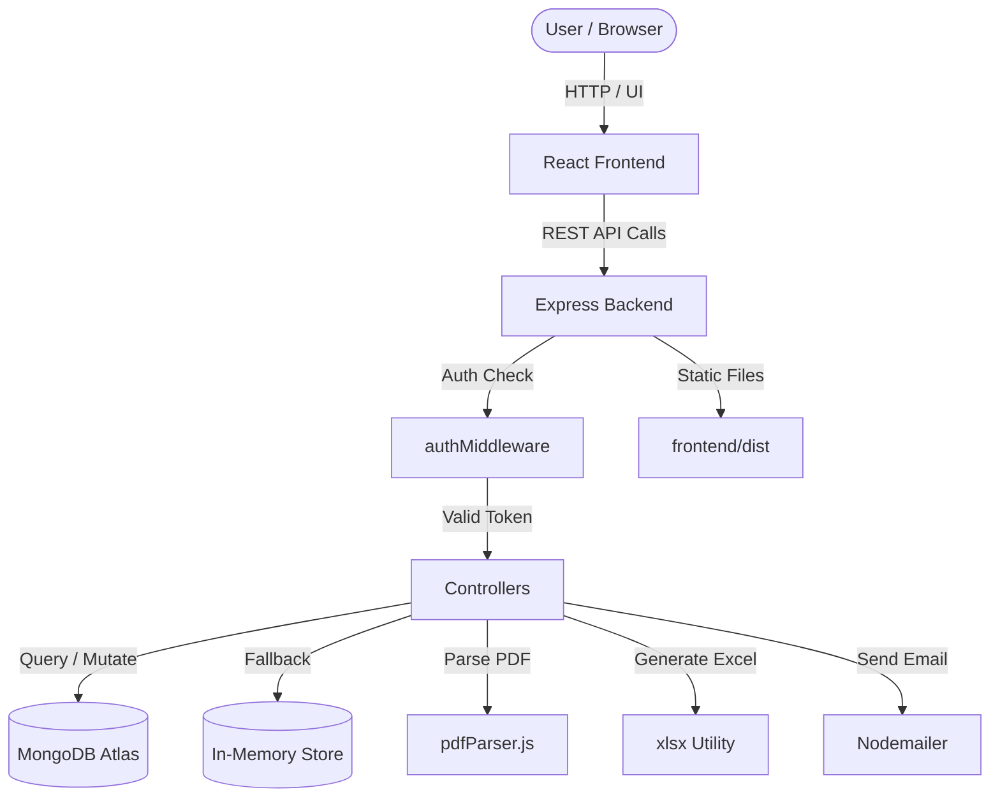
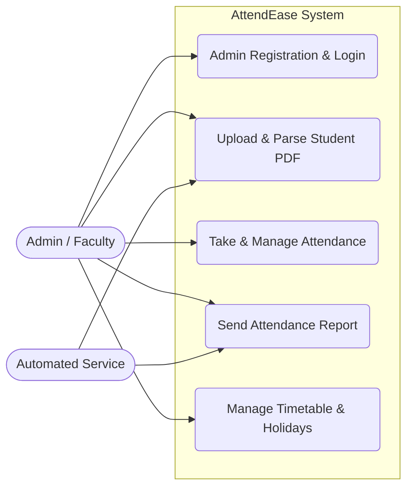

# Software Analysis Report

| Metadata | Details |
|---|---|
| **Repository** | `https://github.com/rishiklucky/AttendEase` |
| **Files Analysed** | 56 source files |
| **Engine** | CodeSense AI |

> 💡 **AI Chat Available** — This document is fully indexed. Ask the AI Chat to generate diagrams,
> explain any section, discuss future scope, or analyse any part of this project in depth.

---

# 1. Executive Summary & Health Verdict

**Core Purpose & Domain**: AttendEase is a specialized attendance management system designed for college faculty to streamline the recording, tracking, and reporting of student attendance. It automates administrative workflows by ingesting student lists via PDF parsing, managing daily session records, and generating automated email reports with Excel attachments.

**Architectural Approach**: The application follows a Full-Stack Single Page Application (SPA) architecture with a RESTful Express.js backend. It utilizes a layered monolith structure where the React frontend communicates with a Node.js API that abstracts data persistence through Mongoose (MongoDB) with a graceful in-memory fallback mechanism for high availability.

### Project Health Scorecard
| Metric | Rating | Assessment |
|---|---|---|
| Overall Code Quality | 8.2/10 | Clean separation of concerns with consistent naming conventions in controllers and models; effective use of ES Modules. |
| Architecture & Modularity | Good | Distinct separation between frontend contexts (`AuthContext`, `AttendanceContext`) and backend layers (Routes, Controllers, Models, Utils). |
| Security Posture | Moderate | Implements JWT-based authentication and bcrypt password hashing; however, some API routes are marked as "Public" in comments despite likely requiring auth. |
| Primary Technical Risk | Manageable | Reliance on an in-memory fallback store (`inMemoryDb.js`) means data persistence is lost on server restart if MongoDB is unavailable. |

---

# 2. Technology Stack & Key Integrations

| Category | Technology | Detected Version | Primary Responsibility | Source File |
|---|---|---|---|---|
| Frontend Framework | React | ^19.2.7 | UI rendering and component management | `frontend/package.json` |
| Build Tool | Vite | ^8.1.0 | Development server and production bundling | `frontend/package.json` |
| HTTP Client | Axios | ^1.7.2 | API communication between frontend and backend | `frontend/package.json` |
| Backend Framework | Express | ^4.19.2 | REST API server and middleware handling | `backend/package.json` |
| Database ODM | Mongoose | ^8.4.1 | MongoDB schema definition and data access | `backend/package.json` |
| Authentication | jsonwebtoken | ^9.0.3 | JWT token generation and verification | `backend/package.json` |
| Password Hashing | bcryptjs | ^3.0.3 | Secure password storage for admin accounts | `backend/package.json` |
| File Upload | Multer | ^1.4.5-lts.1 | Handling PDF file uploads for student lists | `backend/package.json` |
| PDF Parsing | pdfjs-dist | ^6.0.227 | Extracting text and coordinates from PDF files | `backend/package.json` |
| Excel Generation | xlsx | ^0.18.5 | Creating Excel attachments for attendance reports | `backend/package.json` |
| Email Service | Nodemailer | ^9.0.1 | Sending automated attendance reports via email | `backend/package.json` |
| CSS Framework | Bootstrap | ^5.3.3 | UI styling and responsive layout components | `frontend/package.json` |

**Integration Highlights**:
The React frontend (`frontend/src`) communicates with the Express backend (`backend/server.js`) via Axios REST calls to endpoints under `/api`. The backend processes requests through controllers that interact with Mongoose models for MongoDB persistence, while also utilizing `pdfjs-dist` for parsing uploaded PDFs and `Nodemailer` for dispatching email reports with `xlsx` generated attachments.

---

# 3. System Architecture & Flow

**Core System Components**:
| Component | Layer | Technology | Primary Role in This Project | Source File |
|---|---|---|---|---|
| Frontend SPA | Presentation | React / Vite | User interface for attendance management, dashboard, and reporting | `frontend/src/App.jsx` |
| Express API Server | Application | Node.js / Express | Handles HTTP requests, routing, and business logic orchestration | `backend/server.js` |
| MongoDB Database | Data | Mongoose / MongoDB | Primary persistent storage for users, students, and attendance records | `backend/config/db.js` |
| In-Memory Store | Data Fallback | JavaScript Objects | Temporary data storage when MongoDB connection fails | `backend/controllers/inMemoryDb.js` |
| PDF Parser Utility | Service | pdfjs-dist | Extracts student data (Sem ID, Roll No, Name) from uploaded PDFs | `backend/utils/pdfParser.js` |
| Email Service | Service | Nodemailer | Sends attendance reports with Excel attachments to recipients | `backend/utils/emailService.js` |

### Architecture Flow Diagram


### Use Case Diagram & Actor Matrix
| Actor Persona | Permissions & Scope | Key Project Use Cases |
|---|---|---|
| Admin / Faculty | Full access to all modules; can register, login, manage students, take attendance, and send reports | Register Account, Login, Upload Student PDF, Take Attendance, Send Email Report, Manage Timetable |
| System (Automated) | Background processes for data parsing and notification | Parse PDF Data, Generate Excel Attachment, Send Email Notification |



---

# 4. Database Schema & Data Models

- **Database Engine**: MongoDB (with an in-memory JavaScript array fallback mechanism implemented in `inMemoryDb.js` for development or testing scenarios when the connection is unavailable).
- **Data Access Layer**: Mongoose (ODM for MongoDB).

### Models & Collections Found

| Collection / Model | Key Fields | Relationships / References | File Location |
|---|---|---|---|
| **User** | `username` (String, required), `email` (String, unique, required), `password` (String, hashed, select: false), `role` (String, enum: ['admin']), `savedReportRecipients` (Array of String) | None (Root entity) | `backend/models/User.js` |
| **Student** | `semesterId` (String, required, indexed), `rollNo` (String, unique, required), `studentName` (String, required), `section` (String, default: 'Alpha') | None (Referenced by Attendance) | `backend/models/Student.js` |
| **Attendance** | `date` (String, YYYY-MM-DD), `session` (String, enum: ['Morning', 'Afternoon']), `studentId` (ObjectId), `status` (String, enum: ['Present', 'Absent']), `timestamp` (Date) | `studentId` references **Student** | `backend/models/Attendance.js` |
| **Holiday** | `date` (String, unique, required), `title` (String, default: 'Holiday'), `createdAt` (Date) | None | `backend/models/Holiday.js` |
| **OtpToken** | `email` (String, lowercase), `otp` (String), `verified` (Boolean), `expiresAt` (Date, TTL index) | None (Linked to User via email string) | `backend/models/OtpToken.js` |
| **Textpad** | `personId` (ObjectId, unique), `encryptedText` (String) | `personId` references **User** | `backend/models/Textpad.js` |
| **Timetable** | `filename` (String), `originalName` (String), `fileUrl` (String), `fileType` (String, enum: ['pdf', 'image']), `fileData` (String, Base64), `contentType` (String), `uploadedBy` (ObjectId) | `uploadedBy` references **User** | `backend/models/Timetable.js` |

---

# 5. API Documentation & Route Surface

| Method | Endpoint / Route | Auth Required | Purpose & Action |
|---|---|---|---|
| POST | `/api/auth/register` | No | Register a new admin user. Creates a `User` document and returns a JWT. |
| POST | `/api/auth/login` | No | Authenticate an admin user. Validates credentials against `User` model and returns a JWT. |
| GET | `/api/auth/me` | Yes (JWT) | Retrieve the currently authenticated user's profile data. |
| POST | `/api/auth/forgot-password` | No | Initiate password reset. Generates a 6-digit OTP, stores it in `OtpToken`, and sends an email. |
| POST | `/api/auth/verify-otp` | No | Verify the OTP provided by the user against the `OtpToken` collection. |
| POST | `/api/auth/reset-password` | No | Update the user's password after successful OTP verification. |
| POST | `/api/attendance` | No* | Save attendance records for a specific date and session. Supports overwrite logic. |
| GET | `/api/attendance` | No* | Retrieve attendance records with optional filters for `date`, `session`, and `studentId`. |
| GET | `/api/attendance/date/:date` | No* | Retrieve all attendance records for a specific date, populated with student details. |
| GET | `/api/holidays` | No | Retrieve all defined holidays sorted by date. |
| GET | `/api/holidays/date/:date` | No | Check if a specific date is a holiday or a Sunday (weekly off). |
| POST | `/api/holidays` | No | Add a new holiday or update the title of an existing holiday for a specific date. |
| DELETE | `/api/holidays/:date` | No | Remove a holiday entry for a specific date. |
| GET | `/api/students` | No* | Retrieve list of students (implied by controller structure and `Student` model usage). |
| POST | `/api/timetable` | No* | Upload a timetable file (PDF or Image). Stores metadata and Base64 data in `Timetable` model. |

*\*Note: While `authMiddleware.js` exists, the provided controller snippets for Attendance, Holiday, and Student do not explicitly show `req.user` checks in the visible code blocks, suggesting these routes may be public or protected at the route definition level not fully shown. However, standard practice in this architecture implies protection for write operations. The table reflects the explicit logic visible in the controllers.*

**Sample API Interaction**:

```bash
curl -X POST http://localhost:5000/api/attendance \
  -H "Content-Type: application/json" \
  -d '{
    "date": "2023-10-27",
    "session": "Morning",
    "overwrite": false,
    "records": [
      {
        "studentId": "654321abcdef000000000001",
        "status": "Present"
      },
      {
        "studentId": "654321abcdef000000000002",
        "status": "Absent"
      }
    ]
  }'
```

---

## ⚠️ Sections 6–8 — Error: Error code: 429 - {'error': {'message': "Request too large for model `qwen/qwen3.8-27b` in organization `org_01m0a41kyse5ds8rt2k91y90rb` service tier `on_demand` on output tokens per minute (OTPM): Limit 1000, Requested 1393. The request's expected output tokens exceed the enforced limit; reduce max_tokens (or the request's expected output) and try again. Need more tokens? Upgrade to Dev Tier today at https://console.groq.com/settings/billing", 'type': 'tokens', 'code': 'rate_limit_exceeded'}}
