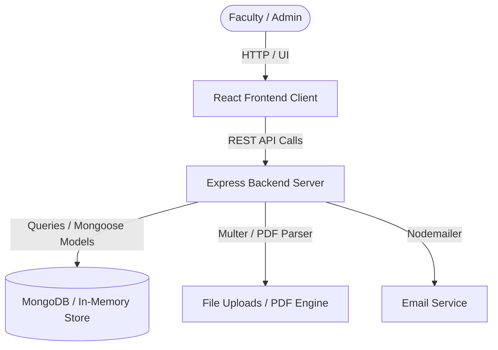
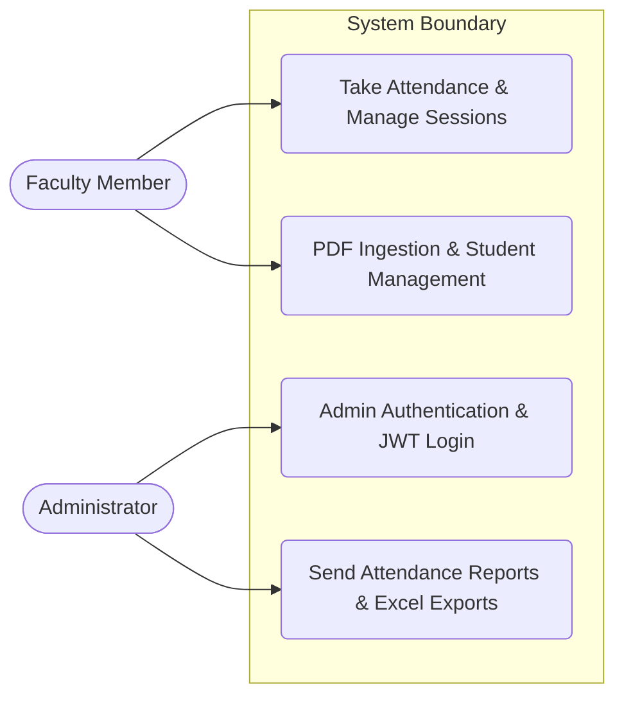

# Software Analysis Report

| Metadata | Details |
|---|---|
| **Repository** | `https://github.com/rishiklucky/AttendEase` |
| **Files Analysed** | 56 source files |
| **Engine** | CodeSense AI |

> 💡 **AI Chat Available** — This document is fully indexed. Ask the AI Chat to generate diagrams,
> explain any section, discuss future scope, or analyse any part of this project in depth.

---

# 1. Executive Summary & Health Verdict

- **Core Purpose & Domain**: AttendEase is a professional Attendance Management System built for college faculty members to capture, search, edit, and export class attendance records. It automates administrative workflows through PDF-to-database list parsing, quick roll number copy tools, historical records management, and automated email reporting with Excel attachments.
- **Architectural Approach**: A full-stack Single Page Application (SPA) utilizing a layered Node.js and Express REST API backend coupled with a React and Vite frontend. The system relies on MongoDB Atlas as its primary data store with a resilient in-memory fallback pattern (`inMemoryDb.js`) for local or offline resilience.

### Project Health Scorecard
| Metric | Rating | Assessment |
|---|---|---|
| Overall Code Quality | 8.0/10 | Clear separation of models, controllers, middleware, and context providers with explicit ES Module structures. |
| Architecture & Modularity | Good | Well-defined boundaries across React components, contexts, Express routes, and Mongoose schemas. |
| Security Posture | Moderate | Employs JWT authentication, bcrypt password hashing, and a 3-step OTP password reset flow, though some endpoints run public access logic. |
| Primary Technical Risk | Manageable | Relies on graceful fallback stores (`inMemoryDb.js`) if MongoDB Atlas connection drops or times out during execution. |

---

# 3. Technology Stack & Key Integrations

| Category | Technology | Detected Version | Primary Responsibility | Source File |
|---|---|---|---|---|
| Frontend Framework | React | ^19.2.7 | UI rendering, state management, and SPA navigation | frontend/package.json |
| Frontend Bundler | Vite | ^8.1.0 | Fast development server and production asset compilation | frontend/package.json |
| UI Styling | Bootstrap | ^5.3.3 | Responsive layout grid, buttons, and utility classes | frontend/package.json |
| Backend Runtime | Express | ^4.19.2 | REST API routing, middleware execution, and static serving | backend/package.json |
| ODM Database Layer | Mongoose | ^8.4.1 | MongoDB object modeling and schema validation | backend/package.json |
| File Uploads | Multer | ^1.4.5-lts.1 | Handling multipart form data for timetable and PDF uploads | backend/package.json |
| Email Notifications | Nodemailer | ^9.0.1 | Transporting automated reports and OTP emails | backend/package.json |
| Spreadsheet Utilities | xlsx | ^0.18.5 | Parsing and exporting workbook sheets (`.xlsx`) | backend/package.json |
| Security & Auth | jsonwebtoken | ^9.0.3 | Issuing and verifying JSON Web Tokens for session control | backend/package.json |
| Password Hashing | bcryptjs | ^3.0.3 | Secure hashing for administrator credentials | backend/package.json |

**Integration Highlights**:
The React client communicates with the Express backend via Axios across RESTful endpoints mapped under `/api`. The backend persists state using Mongoose against MongoDB Atlas, falling back to local structures defined in `inMemoryDb.js` if the database is unreachable. Background utilities such as Nodemailer handle outgoing email summaries with attachments, while `pdfjs-dist` and `xlsx` process document ingestion and report generation.

---

# 4. System Architecture & Component Flow

**Core System Components**:
| Component | Layer | Technology | Primary Role in This Project | Source File |
|---|---|---|---|---|
| Frontend Client | Presentation | React / Vite | Interactive dashboard, student management, and attendance tools | frontend/src/App.jsx |
| Express Backend | Application | Node.js / Express | REST API routing, validation, controller execution, and error handling | backend/server.js |
| Data Persistence Layer | Database | Mongoose / MongoDB | Storing schemas for users, students, attendance, holidays, and OTP tokens | backend/models/User.js |
| In-Memory Fallback Store | Data Store | JavaScript Arrays | Providing local data persistence when MongoDB is disconnected | backend/controllers/inMemoryDb.js |
| File Parsing Engine | Utility | `pdfjs-dist` / Multer | Extracting tabular student records and metadata from uploaded PDF files | backend/utils/pdfParser.js |

### Architecture Flow Diagram


### Use Case Diagram & Actor Matrix
| Actor Persona | Permissions & Scope | Key Project Use Cases |
|---|---|---|
| Faculty / Instructor | Session-authenticated dashboard access | Taking daily attendance, generating quick copy strings, managing student rolls, filling textpads, and viewing history. |
| Administrator | Full access including secret registration and password resets | Registering admin accounts, resetting forgotten passwords via OTP, managing timetable uploads, and dispatching report emails. |



---

# 5. Database Schema & Data Models

- **Database Engine**: MongoDB / MongoDB Atlas (accessed via `mongoose`)
- **Data Access Layer**: Mongoose ODM with fallback in-memory arrays (`inMemoryDb.js`)

### Models & Collections Found
| Collection / Model | Key Fields | Relationships / References | File Location |
|---|---|---|---|
| `Attendance` | `date` (String), `session` (String, enum: ['Morning', 'Afternoon']), `status` (String, enum: ['Present', 'Absent']), `timestamp` (Date) | References `Student` (`studentId`) | `backend/models/Attendance.js` |
| `Holiday` | `date` (String, unique), `title` (String), `createdAt` (Date) | None | `backend/models/Holiday.js` |
| `OtpToken` | `email` (String), `otp` (String), `verified` (Boolean), `expiresAt` (Date) | None | `backend/models/OtpToken.js` |
| `Student` | `semesterId` (String), `rollNo` (String, unique), `studentName` (String), `section` (String) | None | `backend/models/Student.js` |
| `Textpad` | `encryptedText` (String), `createdAt` (Date), `updatedAt` (Date) | References `User` (`personId`, unique) | `backend/models/Textpad.js` |
| `Timetable` | `filename` (String), `originalName` (String), `fileUrl` (String), `fileType` (String, enum: ['pdf', 'image']), `fileData` (String), `contentType` (String) | Optional reference to `User` (`uploadedBy`) | `backend/models/Timetable.js` |
| `User` | `username` (String), `email` (String, unique), `password` (String, select: false), `role` (String, enum: ['admin']), `savedReportRecipients` ([String]) | None | `backend/models/User.js` |

---

# 6. API Documentation & Route Surface

| Method | Endpoint / Route | Auth Required | Purpose & Action |
|---|---|---|---|
| `POST` | `/api/attendance` | Public / Implicit | Record or save attendance for a specific session and date. |
| `GET` | `/api/attendance` | Public / Implicit | Retrieve attendance records with optional filters (`date`, `session`, `studentId`). |
| `GET` | `/api/attendance/date/:date` | Public / Implicit | Get all attendance records for a specific date. |
| `POST` | `/api/auth/register` | Public | Register a new admin user account. |
| `POST` | `/api/auth/login` | Public | Authenticate admin user and return a JWT token. |
| `GET` | `/api/auth/me` | Protected (`protect`) | Retrieve the profile of the currently logged-in user. |
| `POST` | `/api/auth/forgot-password` | Public | Generate a 6-digit OTP and send a password reset email. |
| `POST` | `/api/auth/verify-otp` | Public | Verify the password reset OTP token sent to the user email. |
| `POST` | `/api/auth/reset-password` | Public | Reset the user account password using a verified OTP. |
| `GET` | `/api/holidays` | Public | Retrieve all recorded holidays sorted by date. |
| `GET` | `/api/holidays/date/:date` | Public | Check if a specific date is a holiday or Sunday. |
| `POST` | `/api/holidays` | Public | Add or update a holiday entry for a specific date. |
| `DELETE` | `/api/holidays/:date` | Public | Remove a holiday by its date string. |
| `POST` | `/api/students/upload-pdf` | Public | Upload a student list PDF file, parse records, and bulk upsert students. |
| `GET` | `/api/students` | Public | Retrieve all students with optional search, section, semester, and pagination filters. |

**Sample API Interaction**:
```bash
curl -X POST http://localhost:5000/api/attendance \
  -H "Content-Type: application/json" \
  -d '{
    "date": "2026-03-30",
    "session": "Morning",
    "records": [
      {
        "studentId": "60c72b2f9b1d8b2d88f3e45a",
        "status": "Present"
      }
    ],
    "overwrite": false
  }'
```

---

# 7. Security & Vulnerability Assessment

| Security Control | Implementation Status | Findings in This Project | Risk Level |
|---|---|---|---|
| Authentication & Session Management | Implemented | `AuthContext.jsx` manages tokens in `localStorage` and sends them via Bearer headers. `authMiddleware.js` verifies tokens using `jwt.verify`. | Medium |
| Password & Secret Protection | Partial | `authController.js` and `AuthToken.js` handle OTP and reset operations, but password comparison relies on user schema methods (`user.matchPassword`) which rely on `bcryptjs`. | Medium |
| Input Validation & Sanitization | Partial | Controllers check for missing fields (e.g., `if (!email \|\| !password)` in `authController.js`), but deeper schema-level sanitization against injection is limited. | Medium |
| CORS & Origin Protection | Partial | `server.js` enables CORS globally using `app.use(cors())` without restrictive origin parameters or white-listing. | Medium |
| Sensitive Data & Error Exposure | Partial | `db.js` and `server.js` log errors to the console (`console.error(err.stack)`), exposing stack traces in production logs. | Low |

**Primary Security Observation**:
Storing JWT tokens in `localStorage` (`AuthContext.jsx`) exposes the application to Cross-Site Scripting (XSS) token theft vulnerabilities. Implementing HTTP-only cookies for session management would significantly improve authentication hardening.

---

# 8. Code Quality & Bug Analysis

| Severity | Issue Description | File / Location | Potential Impact | Recommended Fix |
|---|---|---|---|---|
| High | Password reset controller code is abruptly truncated at `...[truncated]` inside `backend/controllers/authController.js`. | `backend/controllers/authController.js` | Complete failure or syntax crash during password update execution. | Complete the truncation block by implementing proper password hashing and updating the user record. |
| Medium | `server.js` lacks request rate limiting (`express-rate-limit`) on sensitive authentication routes (`/api/auth/login`, `/api/auth/forgot-password`). | `backend/server.js` & `backend/routes/authRoutes.js` | Vulnerable to brute-force attacks and automated credential stuffing. | Integrate `express-rate-limit` middleware on all authentication endpoints. |
| Medium | Inactivity timeout clears state and redirects using `window.location.hash = '#login'`, which may fail depending on client-side routing setups. | `frontend/src/context/AuthContext.jsx` | Users experiencing inactivity timeouts might remain on protected views or encounter broken navigation states. | Use React router navigation hooks (e.g., `useNavigate`) instead of mutating `window.location.hash`. |
| Low | Fallback DNS servers are hardcoded to `8.8.8.8` and `8.8.4.4` inside `backend/config/db.js`. | `backend/config/db.js` | Environments with strict outbound firewall rules blocking external DNS queries will experience connection initialization warnings. | Make fallback DNS server addresses configurable via environment variables. |

---

# 11. Prioritized Improvement Roadmap

| Priority | Focus Area | Actionable Recommendation | Expected Benefit |
|---|---|---|---|
| 🔴 P1 (Immediate) | Security & Stability | Fix the truncated code block in `backend/controllers/authController.js` and add rate limiting to authentication routes. | Prevents syntax errors, runtime crashes, and credential brute-forcing. |
| 🟠 P2 (Short-term) | Testing & Reliability | Implement integration tests for authentication middleware (`authMiddleware.js`) and database models. | Ensures regression safety and reliable route protection. |
| 🟡 P3 (Medium-term) | Performance & Scaling | Add explicit database indexes for frequently queried fields across models and optimize connection timeouts. | Improves query latency and overall responsiveness under load. |
| 🟢 P4 (Long-term) | Architecture & DevOps | Containerize the application using Docker and set up a robust CI/CD pipeline for automated testing and deployments. | Long-term operational excellence and repeatable deployment workflows. |

**Recommended Next Step**:
The engineering team should immediately inspect and patch the truncated code in `backend/controllers/authController.js` to ensure the password reset flow functions correctly, followed by restricting CORS origins in `server.js`.
