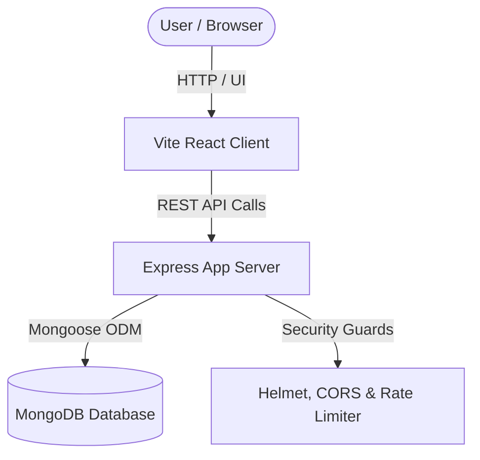
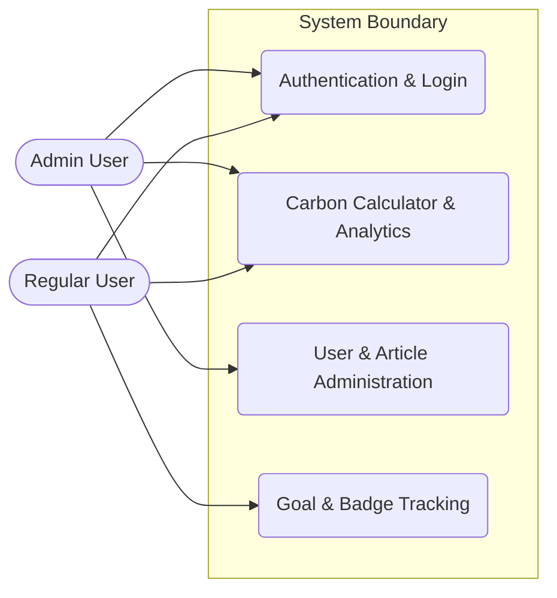

# Software Analysis Report

| Metadata | Details |
|---|---|
| **Repository** | `https://github.com/rishiklucky/EcoTrack` |
| **Files Analysed** | 55 source files |
| **Engine** | CodeSense AI |

> 💡 **AI Chat Available** — This document is fully indexed. Ask the AI Chat to generate diagrams,
> explain any section, discuss future scope, or analyse any part of this project in depth.

---

# 1. Executive Summary & Health Verdict

* **Core Purpose & Domain**: EcoTrack is a full-stack carbon footprint awareness and management platform built for individual users and administrators. It enables users to calculate, analyze, and offset daily carbon emissions through interactive multi-step calculators, dynamic vehicle-type emission coefficients, targeted reduction goals, and gamified achievement badges.
* **Architectural Approach**: The application follows a Layered Monolith pattern with a decoupled frontend single-page application (SPA) communicating with an Express.js REST API backend via HTTP/JSON. Both the client assets and server logic are integrated within a unified repository deployed as a single web service on Render, with persistent data handled via MongoDB and Mongoose ODM.

### Project Health Scorecard
| Metric | Rating | Assessment |
|---|---|---|
| Overall Code Quality | 8.0/10 | Evaluation of structure, naming, and readability |
| Architecture & Modularity | Good | Evaluation of separation of concerns between layers |
| Security Posture | Moderate | Current state of authentication, tokens, and validations |
| Primary Technical Risk | Manageable | The most notable vulnerability or architectural debt |

---

# 3. Technology Stack & Key Integrations

| Category | Technology | Detected Version | Primary Responsibility | Source File |
|---|---|---|---|---|
| Frontend Framework | React | ^19.0.0 | User interface rendering and component composition | `frontend/package.json` |
| UI Framework | Bootstrap | ^5.3.3 | Responsive layout styling, components, and grid system | `frontend/package.json` |
| Client Routing | react-router-dom | ^6.22.3 | Client-side page navigation and protected route wrappers | `frontend/package.json` |
| Data Visualization | Chart.js | ^4.4.2 | Rendering carbon emission analytics graphs and trend lines | `frontend/package.json` |
| HTTP Client | axios | ^1.6.8 | Asynchronous API requests from client pages to backend | `frontend/package.json` |
| Backend Framework | Express | ^4.19.2 | REST API routing, middleware execution, and request handling | `backend/package.json` |
| Database ODM | mongoose | ^8.3.1 | MongoDB object modeling, schema validation, and database queries | `backend/package.json` |
| Authentication | jsonwebtoken | ^9.0.2 | Generating and verifying user session tokens (JWT) | `backend/package.json` |
| Password Hashing | bcryptjs | ^2.4.3 | Secure cryptographic hashing of user passwords | `backend/package.json` |
| Security Headers | helmet | ^7.1.0 | Securing HTTP headers against common web vulnerabilities | `backend/package.json` |
| Rate Limiting | express-rate-limit | ^7.2.0 | Adaptive API rate limiting to prevent abuse | `backend/package.json` |
| Input Validation | express-validator | ^7.0.1 | Validating and sanitizing incoming API request payloads | `backend/package.json` |

**Integration Highlights**:
The React frontend uses `axios` to execute REST API calls against the Express.js backend server. The backend validates requests using `express-validator`, authenticates users via JSON Web Tokens (`jsonwebtoken`), and persists or retrieves structured records via Mongoose ODM connected to MongoDB Atlas. In production environments, the Express server serves the compiled React static bundle built through Vite.

---

# 4. System Architecture & Component Flow

**Core System Components**:
| Component | Layer | Technology | Primary Role in This Project | Source File |
|---|---|---|---|---|
| Vite React Client | Frontend Client | React, Vite, Bootstrap | Renders interactive dashboards, multi-step calculators, and admin panels | `frontend/src/App.jsx` |
| Express App Server | Backend API Server | Node.js, Express.js | Exposes REST endpoints for authentication, activities, goals, articles, and admin controls | `backend/server.js` |
| MongoDB Database | Data Layer | MongoDB, Mongoose | Persists schemas for users, activities, goals, badges, and articles | `backend/config/db.js` |
| Security Middleware | Middleware Layer | Helmet, CORS, Express-Rate-Limit | Enforces HTTP security headers, CORS permissions, and request rate limiting | `backend/server.js` |
| Auth & Validation Guards | Security Layer | JWT, Express-Validator | Verifies bearer tokens and validates user inputs across protected routes | `backend/middleware/auth.js` |

### Architecture Flow Diagram


### Use Case Diagram & Actor Matrix
| Actor Persona | Permissions & Scope | Key Project Use Cases |
|---|---|---|
| Regular User | Authenticated access to personal dashboard, calculator, goals, rewards, education, and profile | Calculating daily carbon emissions, setting sustainability goals, tracking achievement badges, viewing analytical charts |
| Admin User | Elevated administrative privileges across users, articles, and platform metrics | Managing platform users, suspending or deleting accounts, publishing and editing sustainability articles in the CMS |



---

# 5. Database Schema & Data Models

- **Database Engine**: MongoDB Atlas / MongoDB
- **Data Access Layer**: Mongoose ODM

### Models & Collections Found
| Collection / Model | Key Fields | Relationships / References | File Location |
|---|---|---|---|
| Activity | `userId`, `transportation` (`carKm`, `vehicleType`, `bikeKm`, `transitKm`, `flightHrs`), `energy` (`electricityKwh`, `lpgKg`, `waterLitres`), `food` (`dietType`), `waste` (`recyclingRate`, `plasticUsage`), `calculatedScore`, `date` | Refers to `User` (`userId`) | `backend/models/Activity.js` |
| Article | `title`, `category`, `content`, `image`, `readingTime`, `author` | None (Standalone collection) | `backend/models/Article.js` |
| Badge | `name`, `description`, `criteria`, `icon` | None (Referenced by `User`) | `backend/models/Badge.js` |
| Goal | `userId`, `title`, `targetReduction`, `targetDate`, `currentProgress`, `status` | Refers to `User` (`userId`) | `backend/models/Goal.js` |
| User | `name`, `email`, `password`, `role`, `status`, `carbonScore`, `badges` (`badge`, `earnedAt`) | Embeds/Refers to `Badge` | `backend/models/User.js` |

---

# 6. API Documentation & Route Surface

| Method | Endpoint / Route | Auth Required | Purpose & Action |
|---|---|---|---|
| POST | `/api/auth/register` | No | Register a new user |
| POST | `/api/auth/login` | No | Authenticate user & get JWT token |
| GET | `/api/auth/profile` | Yes (`protect`) | Get current authenticated user profile |
| POST | `/api/activities` | Yes (`protect`) | Create or update daily activity footprint |
| GET | `/api/activities` | Yes (`protect`) | Get user activities history |
| PUT | `/api/activities/:id` | Yes (`protect`) | Update an activity log |
| DELETE | `/api/activities/:id` | Yes (`protect`) | Delete an activity log |
| GET | `/api/admin/users` | Yes (`protect`, Admin) | Get all platform users |
| PUT | `/api/admin/users/:id/status` | Yes (`protect`, Admin) | Update user account status (active/suspended) |
| DELETE | `/api/admin/users/:id` | Yes (`protect`, Admin) | Delete a user account and associated activities |
| GET | `/api/admin/analytics` | Yes (`protect`, Admin) | Get platform-wide analytics and averages |
| GET | `/api/articles` | Yes (`protect`) | Get all articles with optional search and category filters |
| POST | `/api/articles` | Yes (`protect`, Admin) | Create a new article |
| POST | `/api/goals` | Yes (`protect`) | Create a new sustainability goal |
| GET | `/api/goals` | Yes (`protect`) | Get user sustainability goals |

**Sample API Interaction**:
```bash
curl -X POST http://localhost:5000/api/activities \
  -H "Content-Type: application/json" \
  -H "Authorization: Bearer YOUR_JWT_TOKEN" \
  -d '{
    "transportation": {
      "carKm": 15,
      "vehicleType": "gasoline",
      "bikeKm": 5,
      "transitKm": 10,
      "flightHrs": 0
    },
    "energy": {
      "electricityKwh": 12,
      "lpgKg": 1,
      "waterLitres": 150
    },
    "food": {
      "dietType": "mixed"
    },
    "waste": {
      "recyclingRate": 50,
      "plasticUsage": "medium"
    }
  }'
```

---

# 7. Security & Vulnerability Assessment

| Security Control | Implementation Status | Findings in This Project | Risk Level |
|---|---|---|---|
| Authentication & Session Management | Implemented | `backend/middleware/auth.js` verifies JSON Web Tokens passed via the `Authorization: Bearer <token>` header against `User.findById`. | Low |
| Password & Secret Protection | Partial | `backend/controllers/authController.js` and `backend/middleware/auth.js` fallback to hardcoded secrets (`'supersecretkeyforecotrackjwttoken123'`) if `process.env.JWT_SECRET` is unset. | High |
| Input Validation & Sanitization | Partial | Controllers like `registerUser` in `backend/controllers/authController.js` manually verify presence of fields (`!name \|\| !email \|\| !password`), but lack strict type checking, sanitization, or Joi/express-validator schemas on most routes. | Medium |
| CORS & Origin Protection | Partial | `backend/server.js` configures `cors({ origin: '*', ... })`, allowing any external domain to query the public API routes during development and production setup. | Medium |
| Sensitive Data & Error Exposure | Implemented | `backend/middleware/errorHandler.js` conditionally suppresses stack traces in production (`stack: process.env.NODE_ENV === 'production' ? null : err.stack`). | Low |

**Primary Security Observation**:
The fallback to hardcoded default JWT signing secrets in `backend/controllers/authController.js` and `backend/middleware/auth.js` exposes the application to token forgery if environment variables are misconfigured in production. Additionally, the wildcard CORS policy (`origin: '*'`) in `backend/server.js` should be restricted to trusted frontend client domains.

---

# 8. Code Quality & Bug Analysis

| Severity | Issue Description | File / Location | Potential Impact | Recommended Fix |
|---|---|---|---|---|
| High | Missing explicit `express-validator` rules in route handlers leaves input parameters unvalidated for format and type. | `backend/routes/authRoutes.js`, `backend/controllers/authController.js` | Malformed payloads or injection attacks could reach database models. | Integrate input validation middleware using `express-validator`. |
| Medium | Hardcoded default fallback strings for `JWT_SECRET` compromise token signature integrity if `process.env` is missing. | `backend/controllers/authController.js`, `backend/middleware/auth.js` | Unauthorized privilege escalation via forged JWTs. | Throw a startup error if `process.env.JWT_SECRET` is undefined instead of using a default string. |
| Medium | `backend/config/db.js` forcibly overrides DNS servers using `dns.setServers(['8.8.8.8', '1.1.1.1'])` in non-production environments without handling restricted corporate network configurations. | `backend/config/db.js` | Connection initialization hangs or fails behind strict corporate firewalls. | Wrap DNS modifications in a conditional check or allow opt-out via an environment variable. |
| Low | `frontend/src/context/AuthContext.jsx` automatically logs out users on any 401 or 403 response, including transient errors or rate-limit rejections. | `frontend/src/context/AuthContext.jsx` | Sudden forced logouts disrupt user experience. | Refine error handling to only clear tokens on explicit authentication failure messages. |

---

# 11. Prioritized Improvement Roadmap

| Priority | Focus Area | Actionable Recommendation | Expected Benefit |
|---|---|---|---|
| 🔴 P1 (Immediate) | Security & Stability | Remove fallback secrets from `authController.js` and `auth.js`; enforce strict environment variable checks. | Eliminates token forgery risks in production deployments. |
| 🟠 P2 (Short-term) | Testing & Reliability | Expand test coverage beyond `backend/tests/calculator.test.js` to include route and controller integration tests. | Prevents regressions during refactoring and feature additions. |
| 🟡 P3 (Medium-term) | Performance & Scaling | Replace wildcard CORS settings (`origin: '*'`) in `server.js` with explicit domain whitelists. | Hardens the perimeter against unauthorized cross-origin requests. |
| 🟢 P4 (Long-term) | Architecture & DevOps | Implement automated CI pipelines via GitHub Actions for building, linting, and testing client and server code. | Ensures consistent build verification prior to Render deployments. |

**Recommended Next Step**:
The engineering team should immediately remove the hardcoded JWT secret fallbacks from the backend controllers and middleware, forcing the application to crash on startup if `JWT_SECRET` is missing. Following this, CORS policies should be updated to restrict API access to authorized frontend origins.
