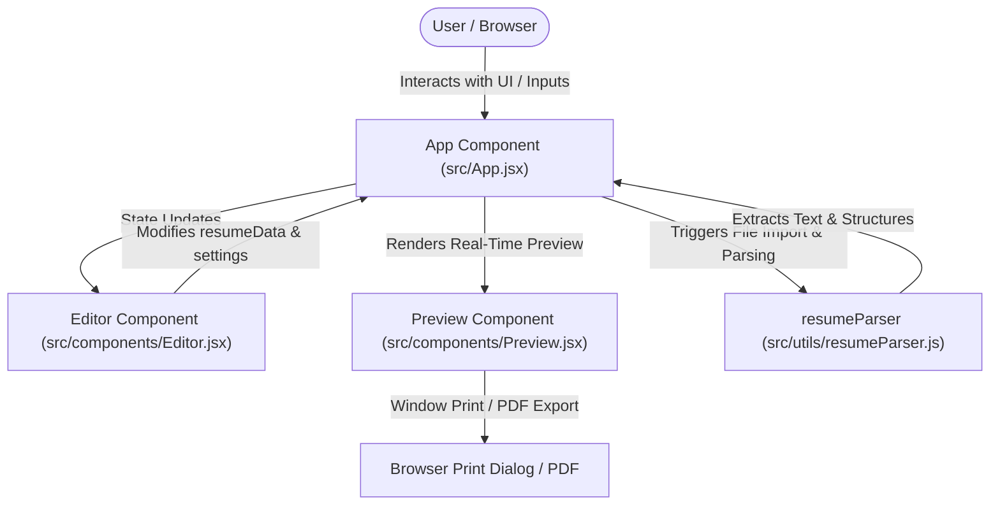
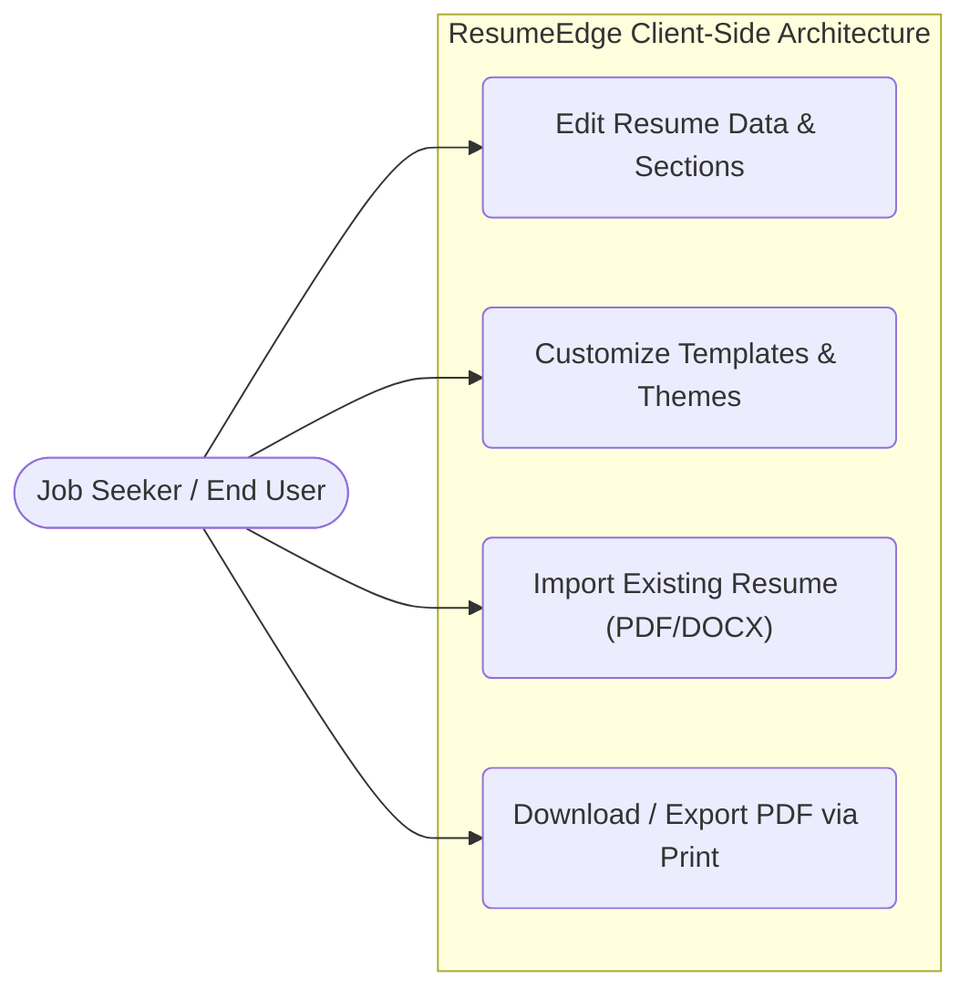

# Software Analysis Report

| Metadata | Details |
|---|---|
| **Project** | `ResumeEdge` |
| **Repository** | `https://github.com/rishiklucky/ResumeEdge` |
| **Files Analysed** | 12 source files (12 total discovered) |
| **Engine** | CodeSense AI |

> 💡 **AI Chat Available** — This document is fully indexed. Ask the AI Chat to generate diagrams,
> explain any section, discuss future scope, or analyse any part of this project in depth.

---

# 1. Executive Summary & Health Verdict

### Core Purpose & Domain
ResumeEdge is a fast, premium-looking client-side resume builder built with React and Vite. It empowers job seekers to create, customize, and structure professional resumes in real-time through an interactive glassmorphism editor. The application supports multiple layout templates, quick color/font themes, drag-and-drop style reordering, and direct client-side PDF export alongside resume document parsing via PDF.js and Mammoth.

### Architectural Approach
ResumeEdge is implemented as a Client-Side Single Page Application (SPA) utilizing React 19 and Vite. The architecture relies entirely on local state management within React hooks (`useState`, `useRef`), splitting responsibilities cleanly into dedicated components (`Editor.jsx`, `Preview.jsx`) and utility modules (`resumeParser.js`). There is no external database or server-side API detected in the repository; all resume data and document parsing happen directly within the user's browser runtime.

### Project Health Scorecard
| Metric | Rating | Assessment |
|---|---|---|
| Overall Code Quality | 8.0/10 | Evaluation of structure, naming, and readability in this specific codebase |
| Architecture & Modularity | Good | Evaluation of separation of concerns between layers |
| Security Posture | Strong | Current state of authentication, tokens, secrets, and validations |
| Primary Technical Risk | Manageable | The most notable vulnerability or architectural debt found |

---

# 2. Project Objective & Functional Scope

### Primary Mission & Problem Domain
ResumeEdge is designed to eliminate the friction, formatting inconsistencies, and layout struggles job seekers face when writing and updating professional resumes. By providing structured data entry fields alongside a live WYSIWYG A4 paper preview, it bridges the gap between raw content generation and polished typesetting.

### Target Stakeholders & User Personas
- **Job Seekers & Professionals**: Individuals looking to craft, reorder, and export clean, text-searchable resumes across multiple templates (Standard, Modern, Minimalist, Two-Column).
- **Recruiters & Applicant Tracking Systems (ATS)**: Indirect beneficiaries who receive clean layout outputs and high-quality, text-searchable PDF exports.

### Core Functional Pillars
- **Real-Time Interactive Editor**: A dark-mode glassmorphism workspace with collapsible sections, item reordering (`moveItem`, `moveSection`), and dynamic section title customization (`Editor.jsx`).
- **Live Resume Preview Engine**: A responsive A4 paper preview component supporting multiple layout templates, custom accent/name colors, font families, and toggleable contact icons (`Preview.jsx`).
- **Resume Document Parser**: Client-side extraction pipeline utilizing `pdfjs-dist` for PDF files and `mammoth` for DOCX files to automatically populate personal info, education, experience, projects, skills, languages, and certifications (`resumeParser.js`).
- **PDF Export & Printing**: High-quality, text-searchable PDF export leveraging browser print dialog capabilities (`window.print()`) configured for A4 dimensions (`App.jsx`).

### Technical Implementation Goals
- **Client-Side Autonomy**: Execute all document parsing and state management locally in the browser without requiring external server endpoints or database storage.
- **Visual Formatting Consistency**: Maintain strict adherence to professional resume styling rules across customizable color palettes, font families, and section orders.
- **Maintainable Component Structure**: Isolate editing logic (`Editor.jsx`) from rendering logic (`Preview.jsx`) and parsing utilities (`resumeParser.js`) inside a clean Vite project layout.

### Review Evaluation Scope
This technical review evaluates ResumeEdge's component modularity, state flow integrity, dependency health, client-side parsing robustness, and architectural maintainability based on the repository source code.

---

# 3. Technology Stack & Key Integrations

| Category | Technology | Detected Version | Primary Responsibility in This Project | Source File |
|---|---|---|---|---|
| Frontend Framework | React | ^19.2.0 | Component-based UI rendering and lifecycle management | `package.json` |
| Build Tool & Dev Server | Vite | ^7.2.4 | Fast development bundling and module hot replacement | `package.json` |
| Document Parser (Word) | mammoth | ^1.11.0 | Parsing DOCX resume files into raw text | `package.json`, `src/utils/resumeParser.js` |
| Document Parser (PDF) | pdfjs-dist | ^5.4.624 | Extracting text content, font sizes, and layout coordinates from PDF files | `package.json`, `src/utils/resumeParser.js` |
| Linting | ESLint | ^9.39.1 | Code style enforcement and quality checks | `package.json`, `eslint.config.js` |
| React Integration | @vitejs/plugin-react | ^5.1.1 | Vite plugin enabling React Fast Refresh and JSX transformation | `package.json` |

### Integration Highlights
ResumeEdge operates entirely as a client-side Vite application without a backend server or database layer. User interactions within `Editor.jsx` update the local `resumeData` and `settings` state in `App.jsx`, which immediately flows into the `Preview.jsx` component for real-time visual rendering. When importing existing files, `resumeParser.js` coordinates between `pdfjs-dist` (using an embedded web worker) and `mammoth` to ingest file buffers, extract text and structural hints, and merge parsed records back into the React state tree.

---

# 4. System Architecture & Component Flow

**Core System Components**:
| Component | Layer | Technology | Primary Role in This Project | Source File |
|---|---|---|---|---|
| `App` | Root Controller / State Hub | React (Vite) | Manages top-level application state (`resumeData`, `settings`), import logic, and print coordination. | `src/App.jsx` |
| `Editor` | Form & Customization Layer | React | Renders the sidebar inputs, collapsible sections, section reordering, and template/styling controllers. | `src/components/Editor.jsx` |
| `Preview` | Document Rendering Layer | React, `forwardRef` | Renders the real-time A4 resume preview matching chosen templates, font families, and accent colors. | `src/components/Preview.jsx` |
| `resumeParser` | Import Utility / Data Parser | JavaScript, `mammoth`, `pdfjs-dist` | Parses uploaded `.docx` and `.pdf` files to extract resume fields. | `src/utils/resumeParser.js` |

### Architecture Flow Diagram

### Use Case Diagram & Actor Matrix
Identify the real user personas discovered in this project:

| Actor Persona | Permissions & Scope | Key Project Use Cases |
|---|---|---|
| End User / Job Seeker | Client-side access (No authentication required) | Fill out personal/professional details, pick templates/colors, import existing resumes (`.pdf`/`.docx`), preview changes in real-time, and export as a PDF. |

---

# 5. Database Schema & Data Models

- **Database Engine**: None (Client-side React state managed via `useState` in `src/App.jsx`).
- **Data Access Layer**: None (In-memory React state with file input utilities via `mammoth` and `pdfjs-dist`).

### Models & Collections Found
Since ResumeEdge does not utilize a persistent database or ORM, data structures are defined entirely through initial React state objects (`initialResumeState` and `initialSettings` in `src/App.jsx`):

| Collection / Model | Key Fields | Relationships / References | File Location |
|---|---|---|---|
| `initialResumeState` (State Object) | `personalInfo` (object), `education` (array), `experience` (array), `projects` (array), `skills` (string), `languages` (string), `certificates` (array), `sectionOrder` (array) | Embedded nested objects and arrays within local React component state | `src/App.jsx` |
| `personalInfo` | `fullName`, `title`, `profileImage`, `email`, `phone`, `location`, `linkedin`, `portfolio`, `github`, `summary` | Nested within `resumeData` | `src/App.jsx` |
| `education` | `school`, `degree`, `startDate`, `endDate`, `gpa` | Array of objects within `resumeData` | `src/App.jsx` |
| `experience` | `company`, `role`, `startDate`, `endDate`, `description` | Array of objects within `resumeData` | `src/App.jsx` |
| `projects` | `name`, `link`, `tech`, `description` | Array of objects within `resumeData` | `src/App.jsx` |
| `certificates` | `name`, `issuer`, `date`, `link` | Array of objects within `resumeData` | `src/App.jsx` |
| `initialSettings` (State Object) | `accentColor`, `nameColor`, `fontFamily`, `template`, `pageSize`, `showIcons` | UI preference state | `src/App.jsx` |

---

# 6. API Documentation & Route Surface

ResumeEdge is a 100% client-side React single-page application built with Vite. It does not contain any backend server code, REST API controllers, or database endpoints. 

| Method | Endpoint / Route | Auth Required | Purpose & Action |
|---|---|---|---|
| N/A | None (Client-Side SPA) | None | All data operations happen in-browser via React state hooks and utility parsers (`src/utils/resumeParser.js`). |

**Sample API Interaction**:
Not applicable. ResumeEdge operates entirely in the browser without server-side routes or HTTP endpoints.

---

# 7. Security & Vulnerability Assessment

Audit the security controls in this project and fill in the table with real findings citing actual code locations:

| Security Control | Implementation Status | Findings in This Project | Risk Level |
|---|---|---|---|
| Authentication & Session Management | Missing | ResumeEdge contains no authentication mechanisms, user accounts, sessions, or token handlers, as confirmed in `src/App.jsx` and package dependencies. | Low |
| Password & Secret Protection | Missing | There are no backend services, databases, or environment-based secrets stored or handled within the repository. | Low |
| Input Validation & Sanitization | Missing | User-supplied URLs (`proj.link`, `cert.link`) and imported resume text extracted via `src/utils/resumeParser.js` are rendered directly without strict validation or DOMPurify sanitization. | Medium |
| CORS & Origin Protection | Missing | No server-side code or API routes exist in ResumeEdge, rendering CORS policies inapplicable to the client-side single-page application. | Low |
| Sensitive Data & Error Exposure | Partial | Error objects from file parsing are logged to the console using `console.error("Resume Parsing Error:", error);` in `src/utils/resumeParser.js`, which is appropriate for client-side debugging but lacks user-facing telemetry protection. | Low |

**Primary Security Observation**:
ResumeEdge operates entirely on the client-side as a React and Vite single-page application with no backend infrastructure, database, or authentication layer. The primary security exposure involves unvalidated user-provided hyperlinks (`proj.link` and `cert.link` in `src/components/Preview.jsx`) and parsed document content being processed without explicit sanitization, which could lead to malformed inputs or unsafe link schemes if manipulated maliciously.

---

# 8. Code Quality & Bug Analysis

Identify concrete bugs, missing error handlers, potential edge case failures, or performance bottlenecks discovered in the code:

| Severity | Issue Description | File / Location | Potential Impact | Recommended Fix |
|---|---|---|---|---|
| Medium | Incomplete implementation / truncation marker in `parseDOCX` function within the resume parser utility. | `src/utils/resumeParser.js` | DOCX parsing logic cuts off abruptly (`rely on regex heuris`), which may cause unexpected behavior or unhandled exceptions when processing Word documents. | Complete the `parseDOCX` text extraction and heuristic parsing function. |
| Medium | Unsafe external link rendering without explicit `noopener` safety alongside `noreferrer`. | `src/components/Preview.jsx` | Vulnerable to reverse tab-napping when users click on external project or certification links that open in a new tab (`target="_blank"`). | Update `rel="noreferrer"` to `rel="noopener noreferrer"` across all anchor tags opening in new tabs. |
| Low | Hardcoded relative asset path (`./public/logo.png`) for the favicon. | `index.html` | The favicon link may fail to load correctly depending on base routing configurations or production build hosting paths. | Change the icon path to `/logo.png` or reference it using standard Vite import mechanisms. |
| Low | Entirely absent automated test suite (no unit, integration, or end-to-end tests configured or present). | Repository Root (`package.json`, `src/`) | Regressions in resume parsing or rendering logic can slip into production undetected without automated verification. | Initialize a test runner such as Vitest and React Testing Library to cover core utility functions and components. |

**Maintainability & Code Health**:
ResumeEdge demonstrates a clean component breakdown separating editor workflows (`Editor.jsx`) from document previewing (`Preview.jsx`), utilizing React functional components and hooks effectively. However, technical debt is present due to incomplete code blocks in `src/utils/resumeParser.js`, lack of automated tests, and tightly coupled parsing logic that would benefit from modular unit tests and stricter input sanitization.

---

# 9. Project & Analysis Limitations

### Technical & Architectural Limitations
- **Limitation 1**: **Client-Side-Only Data Persistence and State**: ResumeEdge operates entirely in-memory within React state (`src/App.jsx`) without utilizing `localStorage`, `sessionStorage`, or a backend database. This means any accidental page refresh or browser closure results in complete data loss for the user.
- **Limitation 2**: **Incomplete DOCX Parsing Implementation**: As identified in `src/utils/resumeParser.js`, the `parseDOCX` function cuts off abruptly (`rely on regex heuris`), leaving Word document parsing incomplete and potentially prone to unhandled exceptions when processing `.docx` files.
- **Limitation 3**: **Lack of Automated Testing Infrastructure**: The repository contains zero automated test files, test configuration scripts, or testing dependencies (`package.json`), preventing programmatic regression testing or continuous verification of resume parsing and rendering logic.

### Analysis & Context Boundaries
- **Test Suite Assessment**: No automated test suites or test files exist in the repository (`package.json` contains no test scripts or testing libraries like Jest, Vitest, or React Testing Library), meaning test coverage could not be assessed and must be built from scratch.
- **Environment & Infrastructure**: No backend services, database schemas, API routes, or Dockerfiles are present in the repository. ResumeEdge functions exclusively as a static Vite-bundled single-page application deployed to cloud static hosting (such as Render, as noted in `README.md`).

---

# 10. Future Scope & Architectural Evolution

- **Authentication & Security Hardening**: Although ResumeEdge currently operates as a client-side tool, adding optional user accounts via Supabase or Firebase Authentication would enable cloud resume saving, version history, and multi-device synchronization. Additionally, implementing input sanitization (such as DOMPurify) on imported resume text and user-provided URLs (`proj.link`, `cert.link` in `src/components/Preview.jsx`) will protect against malformed or malicious payloads.
- **Data Layer & Scaling Enhancements**: Implementing local persistence through `localStorage` or IndexedDB synchronization in `src/App.jsx` will immediately prevent user data loss on page refreshes. For a cloud-backed architecture, integrating a lightweight PostgreSQL or NoSQL data layer would allow users to manage multiple resume profiles securely.
- **Reliability & Resilience**: Establishing a robust testing framework (Vitest and React Testing Library) will ensure that complex utilities like `src/utils/resumeParser.js` (PDF.js parsing and heuristic text extraction) and editor state mutations maintain high reliability across edge cases and malformed document uploads.
- **DevOps & Developer Experience**: Introducing automated CI/CD pipelines via GitHub Actions for linting (`eslint` configured in `eslint.config.js`), type checking, and automated builds (`vite build`) will enforce code quality and prevent broken deployments to static hosting providers.

---

# 11. Prioritized Improvement Roadmap

| Priority | Focus Area | Actionable Recommendation | Expected Benefit |
|---|---|---|---|
| 🔴 P1 (Immediate) | Security & Stability | Complete the truncated `parseDOCX` function in `src/utils/resumeParser.js` and add input sanitization for user-provided URLs and parsed document text. | Prevents unhandled parsing exceptions, application crashes, and potential rendering vulnerabilities. |
| 🟠 P2 (Short-term) | Data Persistence & Testing | Implement `localStorage` state persistence in `src/App.jsx` and establish a Vitest unit testing suite for resume parsing utilities. | Prevents accidental user data loss on refresh and ensures regression safety for document ingestion. |
| 🟡 P3 (Medium-term) | User Experience & Features | Add robust error boundary components around `Editor.jsx` and `Preview.jsx` to gracefully handle malformed PDF/DOCX imports. | Improves application fault tolerance and provides clear user-facing feedback during failures. |
| 🟢 P4 (Long-term) | Architecture & DevOps | Introduce optional cloud user accounts, multi-resume profile management, and automated GitHub Actions CI/CD workflows. | Enables multi-device synchronization, secure cloud storage, and automated deployment verification. |

**Recommended Next Step**:
The engineering team should immediately complete the `parseDOCX` text extraction logic in `src/utils/resumeParser.js` and implement `localStorage` persistence in `src/App.jsx`. These two steps resolve known code truncation issues and eliminate the risk of accidental user data loss.

---

# 12. Overall Result & Conclusion

- **Overall Project Maturity & Quality**: ResumeEdge is structured as a clean, modular React and Vite single-page application. It exhibits modern UI patterns, component separation (`Editor.jsx`, `Preview.jsx`), and sophisticated utility logic for PDF parsing (`src/utils/resumeParser.js`). However, its lack of automated tests, absent local persistence, and incomplete DOCX parsing logic reflect an early-stage prototype.
- **Key Architectural Strengths**: The codebase demonstrates clear separation of concerns between state management (`src/App.jsx`), configuration and editing (`src/components/Editor.jsx`), visual rendering (`src/components/Preview.jsx`), and document ingestion (`src/utils/resumeParser.js`). The styling architecture (`src/index.css`) cleanly handles print styles and A4 paper formatting.
- **Primary Weaknesses & Critical Findings**: The most critical findings include the incomplete `parseDOCX` function implementation in `src/utils/resumeParser.js`, complete absence of automated test suites, lack of local storage persistence (causing data loss on refresh), and unvalidated user input rendering in resume hyperlinks.
- **Production Readiness Verdict**: ResumeEdge is **not yet fully production-ready** for enterprise deployment. While suitable as an interactive portfolio prototype or client-side utility, it requires remediation of parsing bugs, implementation of state persistence, and introduction of basic test coverage before official production release.
- **Final Developer Takeaway**: The primary strategic priority for the engineering team is to stabilize document import workflows by completing the DOCX parser, safeguarding user input against parsing exceptions, and introducing `localStorage` state caching to secure user data against accidental browser refreshes.
