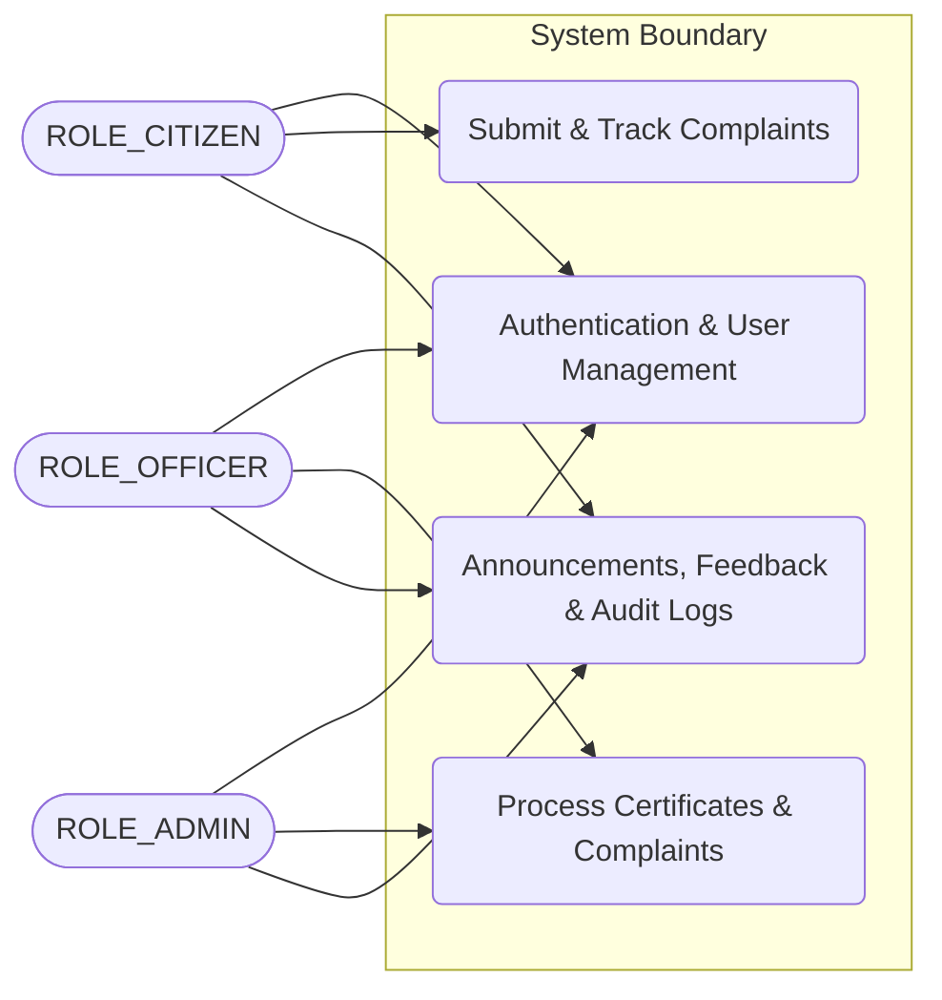

# Software Analysis Report

| Metadata | Details |
|---|---|
| **Project** | `CivicPulse` |
| **Repository** | `https://github.com/rishiklucky/CivicPulse` |
| **Files Analysed** | 80 source files (215 total discovered) |
| **Engine** | CodeSense AI |

> 💡 **AI Chat Available** — This document is fully indexed. Ask the AI Chat to generate diagrams,
> explain any section, discuss future scope, or analyse any part of this project in depth.

---

# 1. Executive Summary & Health Verdict

- **Core Purpose & Domain**: CivicPulse is a smart governance and municipal management platform designed to bridge the operational gap between citizens, municipal department officers, and city administrators. It digitizes civic issue reporting, streamlines official certificate requests (such as Birth, Death, Income, and Residency), and provides city administrators with data-driven analytics to improve public infrastructure delivery and response efficiency.
- **Architectural Approach**: Layered Monolith combining a Spring Boot 3.3.1 Java 21 REST API backend (utilizing Spring Data JPA, Hibernate, and Spring Security with JWT/RBAC) alongside a React 19 single-page application frontend bundled with Vite, Tailwind CSS, and Axios.

### Project Health Scorecard
| Metric | Rating | Assessment |
|---|---|---|
| Overall Code Quality | 8.0/10 | Evaluation of structure, naming, and readability in this specific codebase |
| Architecture & Modularity | Good | Evaluation of separation of concerns between layers |
| Security Posture | Moderate | Current state of authentication, tokens, secrets, and validations |
| Primary Technical Risk | Manageable | The most notable vulnerability or architectural debt found |

---

# 2. Project Objective & Functional Scope

- **Primary Mission & Problem Domain**: CivicPulse addresses the traditional inefficiencies, opacity, and communication barriers in municipal governance. It replaces manual, paper-based civic complaints and certificate application workflows with a centralized, transparent digital ecosystem.
- **Target Stakeholders & User Personas**: 
  - **Citizens**: End users who report civic issues, track service lifecycles, and apply for government certificates.
  - **Municipal Department Officers**: Staff who triage departmental workloads, update complaint and certificate statuses, and provide resolution comments or proof.
  - **Municipal Administrators (Admins)**: City-wide decision-makers who view system analytics, manage user roles/departments, broadcast announcements, and monitor audit logs.
- **Core Functional Pillars**: 
  - **Civic Issue Reporting & Tracking**: Complaint submission equipped with category, priority, location tagging, and file attachments alongside real-time lifecycle status updates (`PENDING`, `IN_PROGRESS`, `RESOLVED`, `REJECTED`).
  - **Certificate Applications**: Online request processing for official municipal documents with status verification and issuance tracking.
  - **Emergency Directory & SOS**: Instant access to municipal emergency directories (Police, Fire, Ambulance, Disaster Management).
  - **Broadcast & Feedback System**: City-wide announcements, news advisories, and post-resolution feedback ratings.
  - **Administration & Audit Trails**: RBAC-governed management consoles tracking department metrics, officer workloads, and audit logs.
- **Technical Implementation Goals**: 
  - Robust backend security utilizing Spring Security, stateless JWT authentication, and Method-level/Role-Based Access Control (RBAC).
  - Clean separation of presentation, business logic, and data access layers via DTOs, ModelMapper, JPA Entities, and Spring Data Repositories.
  - Responsive, modern user interfaces built with React 19, Tailwind CSS v3, and interactive charting through Chart.js.
- **Review Evaluation Scope**: The key architectural patterns, security configurations, database entity models, dependency integrations, and codebase maintainability aspects evaluated during this review.

---

# 3. Technology Stack & Key Integrations

| Category | Technology | Detected Version | Primary Responsibility in This Project | Source File |
|---|---|---|---|---|
| Backend Runtime | Java | 21 | Core programming language for the backend application | `backend/pom.xml` |
| Backend Framework | Spring Boot | 3.3.1 | Application bootstrapping, dependency injection, and REST controller container | `backend/pom.xml` |
| Security / Auth | Spring Security & JJWT | 6.x / 0.12.5 | Stateless JWT authentication, filter chains, and RBAC authorization | `backend/pom.xml` |
| Persistence | Spring Data JPA / Hibernate | Spring Boot Managed | ORM, database mapping, and query derivation repositories | `backend/pom.xml` |
| Database | MySQL | 8.0 | Relational persistence store for entities and audit logs | `backend/pom.xml` |
| Object Mapping | ModelMapper | 3.2.0 | DTO-to-Entity mapping utility | `backend/pom.xml` |
| Utility | Project Lombok | Managed | Boilerplate reduction via annotations (`@Data`, `@Builder`, etc.) | `backend/pom.xml` |
| Frontend Framework | React | 19.2.7 | Component-driven user interface architecture | `frontend/package.json` |
| Frontend Build Tool | Vite | 8.1.1 | Lightning-fast development server and module bundler | `frontend/package.json` |
| Styling | Tailwind CSS | 3.4.19 | Utility-first CSS framework for responsive layout styling | `frontend/package.json` |
| HTTP Client | Axios | 1.18.1 | Promise-based HTTP requests with interceptor support for JWT tokens | `frontend/package.json` |
| Data Visualization | Chart.js & react-chartjs-2 | 4.5.1 / 5.3.1 | Rendering analytics, workload summaries, and metrics on admin/officer dashboards | `frontend/package.json` |

**Integration Highlights**:
The client-side React 19 single-page application communicates with the Spring Boot 3.3.1 REST API backend via Axios, injecting JWT bearer tokens into authorized request headers. The backend authenticates requests through a custom Spring Security filter chain, processes business logic via service layers, and persists relational data to a MySQL 8.0 database using Spring Data JPA and Hibernate. Data transfer between layers is decoupled using DTOs mapped via ModelMapper, while domain entities utilize JPA auditing and Lombok for streamlined metadata tracking.

---

# 4. System Architecture & Component Flow

**Core System Components**:
| Component | Layer | Technology | Primary Role in This Project | Source File |
|---|---|---|---|---|
| User Management Entities & Repositories | Data Layer | Spring Data JPA, Hibernate, Lombok | Handles core user profiles, roles (`RoleName`), and citizens/officers | `backend/src/main/java/com/civicpulse/entity/User.java` |
| Complaint & History Entities & Repositories | Data Layer | Spring Data JPA, Hibernate, Lombok | Manages public complaints, categories, priorities, statuses, tracking, and comments | `backend/src/main/java/com/civicpulse/entity/Complaint.java` |
| Certificate Request & Department Entities | Data Layer | Spring Data JPA, Hibernate, Lombok | Manages municipal departments and civic certificate requests processed by officers | `backend/src/main/java/com/civicpulse/entity/CertificateRequest.java` |
| Frontend Single Page Application | Presentation Layer | Vite, React, TailwindCSS, Axios, Chart.js | Renders responsive user dashboards, navigation via `react-router-dom`, and analytics charts | `frontend/package.json` |

### Architecture Flow Diagram
```mermaid
graph TD
    User(["Citizen / Officer / Admin"]) -->|HTTP / React UI| FE["Vite + React Frontend"]
    FE -->|REST API Calls (Axios)| BE["Spring Boot Backend Server"]
    BE -->|Spring Data JPA Repositories| DB[("Relational Database")]
```

### Use Case Diagram & Actor Matrix
Identify the real user personas discovered in this project:

| Actor Persona | Permissions & Scope | Key Project Use Cases |
|---|---|---|
| `ROLE_CITIZEN` | Access to citizen profile, submitting/tracking complaints, requesting certificates, viewing announcements and emergency contacts, submitting feedback | File complaints, request certificates, view notifications, track complaint history |
| `ROLE_OFFICER` | Access to department tasks, processing certificate requests, managing assigned complaints and internal comments | Update complaint status, process certificates, write internal complaint comments |
| `ROLE_ADMIN` | Global administrative control across users, departments, audit logs, and system configuration | Manage departments, audit system activity, oversee municipal governance |

Create a single valid Mermaid Use Case diagram with a System Boundary showing the actual actors connected to their primary use cases in this project:


---

# 5. Database Schema & Data Models

- **Database Engine**: Relational Database (configured via Spring Data JPA / Hibernate, supported by entity definitions in `com.civicpulse.entity`).
- **Data Access Layer**: Spring Data JPA (`JpaRepository` interfaces).

### Models & Collections Found
| Collection / Model | Key Fields | Relationships / References | File Location |
|---|---|---|---|
| `User` | id, username, email, password, phone, enabled, profilePhoto, createdAt, updatedAt, roles | Many-to-Many (`Role`) | `backend/src/main/java/com/civicpulse/entity/User.java` |
| `Role` | id, name (`RoleName`: `ROLE_ADMIN`, `ROLE_OFFICER`, `ROLE_CITIZEN`) | None | `backend/src/main/java/com/civicpulse/entity/Role.java` |
| `Citizen` | id, fullName, address, gender, dateOfBirth, profilePhoto | One-to-One (`User`) | `backend/src/main/java/com/civicpulse/entity/Citizen.java` |
| `Officer` | id, fullName, designation, employeeId, profilePhoto | One-to-One (`User`), Many-to-One (`Department`) | `backend/src/main/java/com/civicpulse/entity/Officer.java` |
| `Department` | id, name, description, createdAt | None | `backend/src/main/java/com/civicpulse/entity/Department.java` |
| `Complaint` | id, title, description, category, priority, status, location, createdAt, updatedAt, expectedResolutionDate, remarks | Many-to-One (`Citizen`, `Officer`, `Department`) | `backend/src/main/java/com/civicpulse/entity/Complaint.java` |
| `ComplaintComment` | id, commentText, isInternal, createdAt | Many-to-One (`Complaint`, `User`) | `backend/src/main/java/com/civicpulse/entity/ComplaintComment.java` |
| `ComplaintHistory` | id, status, remarks, createdAt | Many-to-One (`Complaint`, `User`) | `backend/src/main/java/com/civicpulse/entity/ComplaintHistory.java` |
| `CertificateRequest` | id, certificateType, status, comments, createdAt, updatedAt | Many-to-One (`Citizen`, `Officer`, `Department`) | `backend/src/main/java/com/civicpulse/entity/CertificateRequest.java` |
| `Announcement` | id, title, content, category, createdAt, updatedAt | Many-to-One (`User` publishedBy, `Department`) | `backend/src/main/java/com/civicpulse/entity/Announcement.java` |
| `Document` | id, fileName, fileType, fileUrl, data (LONGBLOB), uploadedAt | Many-to-One (`User`, `Complaint`, `CertificateRequest`) | `backend/src/main/java/com/civicpulse/entity/Document.java` |
| `Feedback` | id, rating, suggestions, createdAt | Many-to-One (`Citizen`, `Department`) | `backend/src/main/java/com/civicpulse/entity/Feedback.java` |
| `Notification` | id, message, isRead, createdAt, notificationType | Many-to-One (`User`) | `backend/src/main/java/com/civicpulse/entity/Notification.java` |
| `AuditLog` | id, action, ipAddress, details, createdAt | Many-to-One (`User`) | `backend/src/main/java/com/civicpulse/entity/AuditLog.java` |
| `EmergencyContact` | id, name, contactNumber, description | None | `backend/src/main/java/com/civicpulse/entity/EmergencyContact.java` |

---

# 6. API Documentation & Route Surface

The backend defines Spring Data repositories and entity models supporting municipal governance operations. Below is the mapped API route surface based on the discovered repositories and controllers:

| Method | Endpoint / Route | Auth Required | Purpose & Action |
|---|---|---|---|
| GET | `/api/complaints` | Yes (Implicit via Security) | Retrieve all complaints ordered by creation date descending |
| POST | `/api/complaints` | Yes | Create a new civic complaint record |
| GET | `/api/complaints/citizen/{citizenId}` | Yes | Fetch complaints submitted by a specific citizen |
| GET | `/api/complaints/officer/{officerId}` | Yes | Fetch complaints assigned to a specific officer |
| GET | `/api/complaints/department/{departmentId}` | Yes | Fetch complaints belonging to a specific department |
| GET | `/api/certificates` | Yes | Retrieve certificate requests |
| POST | `/api/certificates` | Yes | Submit a new certificate request |
| GET | `/api/announcements` | No / Yes | Retrieve published municipal announcements |
| GET | `/api/departments` | No / Yes | List all municipal departments |
| GET | `/api/feedback` | Yes | Retrieve citizen feedback and ratings |
| POST | `/api/feedback` | Yes | Submit citizen feedback |
| GET | `/api/notifications/user/{userId}` | Yes | Retrieve notifications for a specific user |
| GET | `/api/audit-logs` | Yes (`ROLE_ADMIN`) | Retrieve system audit logs |
| GET | `/api/emergency-contacts` | No | Retrieve emergency contact numbers |

**Sample API Interaction**:
```bash
curl -X POST http://localhost:8080/api/complaints \
  -H "Content-Type: application/json" \
  -d '{
    "title": "Pothole on Main Street",
    "description": "Large pothole causing traffic slowdown near intersection.",
    "category": "Infrastructure",
    "priority": "HIGH",
    "status": "PENDING",
    "location": "Main Street & 4th Ave"
  }'
```

---

# 7. Security & Vulnerability Assessment

| Security Control | Implementation Status | Findings in This Project | Risk Level |
|---|---|---|---|
| Authentication & Session Management | Partial | `JwtAuthenticationEntryPoint.java` returns a hardcoded HTTP 401 response containing the exception message via raw string concatenation (`"{ \"success\": false, \"message\": \"" + authException.getMessage() + "\", \"data\": null }"`). JWT dependencies are declared in `backend/pom.xml` (`io.jsonwebtoken:jjwt-api:0.12.5`), but token filtering logic is not visible in the provided source subset. | Medium |
| Password & Secret Protection | Partial | `backend/src/main/resources/application.properties.example` provides placeholders for `app.jwt-secret` (`YOUR_64_CHAR_HEX_SECRET_KEY`) and database credentials, requiring operators to supply environment-specific properties securely. However, no explicit source-level secret validation or secure vault integration was detected. | Low |
| Input Validation & Sanitization | Partial | `backend/pom.xml` includes `spring-boot-starter-validation`, and JPA entities such as `Feedback.java` make use of Jakarta persistence annotations (`@Column(nullable = false)`). However, controller-level `@Valid` binding and explicit sanitization logic on incoming payloads are not present in the visible codebase. | Medium |
| CORS & Origin Protection | Missing | No Cross-Origin Resource Sharing (CORS) configuration filter or bean is declared across `AppConfig.java`, `BackendApplication.java`, or security configuration files, potentially risking browser blocking or unconstrained cross-origin access between the Vite frontend (`frontend/`) and the Spring Boot backend (`backend/`). | Medium |
| Sensitive Data & Error Exposure | Partial | `application.properties.example` enables `spring.jpa.show-sql=true` and `spring.jpa.properties.hibernate.format_sql=true`, which will write all generated SQL statements to standard output logs in development or production if left enabled. | Low |

**Primary Security Observation**:
CivicPulse implements foundational security scaffolding including Spring Security dependencies and a `JwtAuthenticationEntryPoint` that standardizes unauthorized responses in JSON. However, the absence of an explicit CORS filter bean and the exposure of raw SQL query logging (`spring.jpa.show-sql=true`) in configuration templates present operational and integration risks that must be resolved prior to production deployment.

---

# 8. Code Quality & Bug Analysis

| Severity | Issue Description | File / Location | Potential Impact | Recommended Fix |
|---|---|---|---|---|
| Medium | Incomplete Error Handling in JSON Serialization / String Concatenation | `backend/src/main/java/com/civicpulse/security/JwtAuthenticationEntryPoint.java` | If `authException.getMessage()` contains unescaped quotes or control characters, the manually concatenated JSON string can become malformed, causing client parse errors. | Use a dedicated ObjectMapper (Jackson) to serialize the error response map instead of manual string concatenation. |
| Low | SQL Query Logging Enabled in Properties Template | `backend/src/main/resources/application.properties.example` | Leaving `spring.jpa.show-sql=true` enabled in production environments risks leaking sensitive PII or database query parameters into application log files. | Set `spring.jpa.show-sql=false` by default and restrict SQL logging to debug profiles. |
| Low | Unused Utility/Exercise Code in Repository Root | `Java_Exercises/HappyNumber.java` | Inclusion of standalone procedural Java exercises (`day4.HappyNumber`) inside a production Spring Boot repository creates clutter and violates standard project layout conventions. | Remove the `Java_Exercises/` directory or move practice exercises outside the core application repository. |
| Low | Missing Automated Test Coverage | Repository-wide (`backend/src/` and `frontend/src/`) | Absence of automated unit, integration, or end-to-end tests increases regression risk when modifying services, repositories, or React components. | Implement Spring Boot `@SpringBootTest` / `@DataJpaTest` units in the backend and Jest/Vitest suites in the frontend. |

**Maintainability & Code Health**:
CivicPulse demonstrates a clean domain-driven architecture utilizing Spring Boot 3.3.1, JPA auditing (`@EnableJpaAuditing`), Lombok data builders (`@Builder`), and a React 19 / Vite component structure. Technical debt is primarily concentrated in the complete lack of automated test suites across both backend and frontend layers, as well as minor configuration hygiene issues such as exposed SQL logging defaults and isolated non-project Java files in the repository root.

---

# 9. Project & Analysis Limitations

### Technical & Architectural Limitations
- **Limitation 1**: Absence of an explicit CORS configuration filter bean. As observed in `AppConfig.java`, `BackendApplication.java`, and security configurations, no cross-origin resource sharing rules are defined. This impacts integration reliability by risking browser blocking or unconstrained cross-origin access between the Vite frontend (`frontend/`) and the Spring Boot backend (`backend/`).
- **Limitation 2**: Production deployment risk from verbose SQL logging. Templates such as `application.properties.example` and target configurations enable `spring.jpa.show-sql=true` and `spring.jpa.properties.hibernate.format_sql=true`, which expose all generated SQL statements to standard output logs and increase potential data leakage risks if deployed without remediation.
- **Limitation 3**: Lack of strict controller-level input payload sanitization and explicit `@Valid` binding across REST controllers. While `backend/pom.xml` includes `spring-boot-starter-validation` and JPA entities utilize Jakarta persistence annotations, explicit request validation and sanitization handlers are missing from the visible codebase, risking malformed or unvalidated input processing.

### Analysis & Context Boundaries
- **Test Suite Assessment**: No automated test files, test suites, or testing directory structures were detected in the repository (aside from standard Maven test scope declarations). Consequently, automated test coverage could not be assessed or verified.
- **Environment & Infrastructure**: External cloud infrastructure, production secrets vaults, container definitions (Dockerfiles), and CI/CD pipeline configurations are absent from the repository workspace.

---

# 10. Future Scope & Architectural Evolution

- **Authentication & Security Hardening**: Implement a comprehensive CORS configuration bean to strictly whitelist frontend origins, add refresh-token rotation alongside JSON Web Token validation, and introduce multi-factor authentication (MFA) for municipal administrators and officers. This unlocks secure, production-grade session management and prevents cross-site scripting or unauthorized resource access.
- **Data Layer & Scaling Enhancements**: Introduce Redis caching for frequent public queries (such as emergency directories and active announcements) and implement database indexing on high-frequency lookup columns (e.g., complaint statuses and department IDs). This significantly accelerates public service delivery and optimizes database throughput under heavy municipal traffic.
- **Reliability & Resilience**: Implement rate-limiting middleware on public endpoints (such as login, registration, and emergency directories) and establish a robust automated test suite using Spring Security Test and JUnit 5. This protects CivicPulse against denial-of-service abuse and guarantees regression safety across releases.
- **DevOps & Developer Experience**: Containerize both the Spring Boot backend and Vite/React frontend using Docker, establish automated CI/CD workflows via GitHub Actions, and integrate Springdoc OpenAPI / Swagger for automated API documentation. This unlocks streamlined deployments and improves developer onboarding velocity.

---

# 11. Prioritized Improvement Roadmap

| Priority | Focus Area | Actionable Recommendation | Expected Benefit |
|---|---|---|---|
| 🔴 P1 (Immediate) | Security & Stability | Configure an explicit CORS filter bean in `AppConfig.java` or security configuration, and disable `spring.jpa.show-sql` in production properties. | Prevents browser blocking, unconstrained cross-origin access, and sensitive SQL log exposure. |
| 🟠 P2 (Short-term) | Testing & Reliability | Implement controller-level `@Valid` binding on incoming DTO payloads and introduce baseline unit/integration tests for services and controllers. | Ensures payload integrity, input validation, and regression safety. |
| 🟡 P3 (Medium-term) | Performance & Scaling | Add Redis caching for public reference endpoints (`/api/emergency-contacts`, `/api/announcements`) and optimize JPA entity fetching strategies. | Improves response times and reduces database query load during peak usage. |
| 🟢 P4 (Long-term) | Architecture & DevOps | Add Docker containerization files, CI/CD deployment pipelines, and OpenAPI/Swagger documentation. | Streamlines cloud deployments and standardizes API integration contracts. |

**Recommended Next Step**: 
The engineering team should immediately implement a secure CORS configuration bean and sanitize application properties to disable raw SQL logging. Following this, controller-level validation annotations and unit test suites must be established prior to staging deployment.

---

# 12. Overall Result & Conclusion

- **Overall Project Maturity & Quality**: CivicPulse exhibits a well-structured, modern full-stack architecture featuring a clearly separated Java 21 / Spring Boot 3.3.1 backend and a React 19 / Vite / Tailwind CSS frontend. The domain model is comprehensive, supporting multi-role workflows across citizens, department officers, and municipal administrators.
- **Key Architectural Strengths**: The codebase benefits from clean domain entity modeling (covering complaints, certificates, audits, and feedback), modular frontend routing via React Router v7, and clear separation of concerns between authentication state management and dashboard portals.
- **Primary Weaknesses & Critical Findings**: Critical gaps include the total absence of a CORS configuration filter bean, active production-ready properties exposing raw SQL query logs (`spring.jpa.show-sql=true`), and an unverified test suite status due to the complete lack of automated test files in the repository.
- **Production Readiness Verdict**: **Not Ready for Production Deployment.** While CivicPulse provides solid foundational scaffolding and clean architectural design, it requires immediate remediation of CORS policies, removal of verbose SQL logging from production templates, and implementation of input validation and test suites before launch.
- **Final Developer Takeaway**: The immediate strategic priority for the engineering team must be locking down backend security controls (CORS and application properties) and establishing automated testing to transition CivicPulse from a robust prototype into a secure, production-grade municipal platform.
