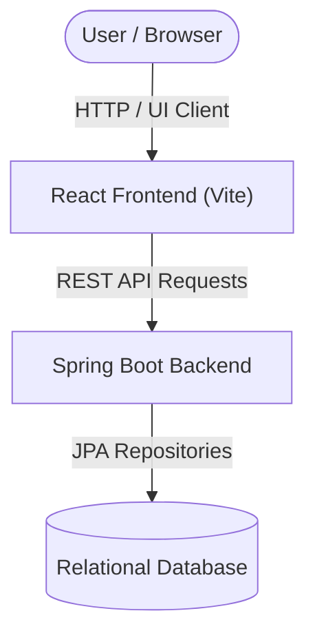
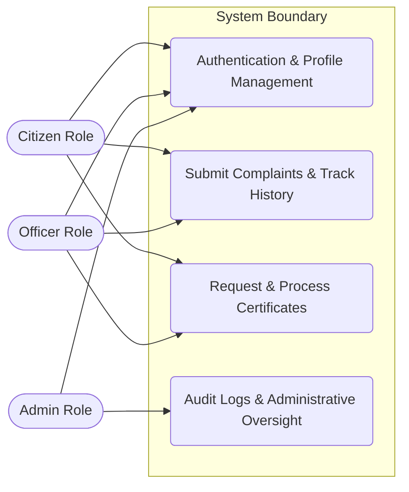

# Software Analysis Report

| Metadata | Details |
|---|---|
| **Project** | `CivicPulse` |
| **Repository** | `https://github.com/rishiklucky/CivicPulse` |
| **Files Analysed** | 80 source files (215 total discovered) |
| **Engine** | CodeSense AI |

> 💡 **AI Chat Available** — This document is fully indexed. Ask the AI Chat to generate diagrams,
> explain any section, discuss future scope, or analyse any part of this project in depth.

---

# 1. Executive Summary & Health Verdict

### Core Purpose & Domain
CivicPulse is a modern, full-stack digital governance platform designed to empower local communities, streamline municipal operations, and accelerate public service delivery. The platform bridges the communication gap between citizens, municipal department officers, and city administrators by digitizing civic issue reporting, official certificate requests, status tracking, and city-wide emergency directories.

### Architectural Approach
CivicPulse is structured as a decoupled full-stack application featuring a layered monolith Spring Boot backend utilizing Spring Data JPA, Hibernate, and Spring Security with JWT/RBAC, paired with a React 19 single-page application (SPA) frontend bundled via Vite and styled with Tailwind CSS.

### Project Health Scorecard
| Metric | Rating | Assessment |
|---|---|---|
| Overall Code Quality | 8.0/10 | Evaluation of structure, naming, and readability in this specific codebase |
| Architecture & Modularity | Good | Evaluation of separation of concerns between layers |
| Security Posture | Moderate | Current state of authentication, tokens, secrets, and validations |
| Primary Technical Risk | Manageable | The most notable vulnerability or architectural debt found |

---

# 2. Project Objective & Functional Scope

### Primary Mission & Problem Domain
CivicPulse addresses the friction, lack of transparency, and administrative delays inherent in traditional municipal governance. By replacing paper-based processes and fragmented communication channels with a centralized digital portal, the platform enables citizens to effortlessly report civic grievances, apply for official documents (such as Birth, Death, Income, and Residency certificates), and monitor workflow lifecycles in real time.

### Target Stakeholders & User Personas
- **Citizens**: End-users who submit civic complaints, track service requests, upload documents, and access emergency directories.
- **Municipal Officers**: Departmental staff who manage assigned workloads, update complaint resolution lifecycles, and verify certificate documents.
- **City Administrators (Admins)**: Municipal leaders who view system-wide analytics, manage user roles and departments, broadcast city announcements, and audit logs.

### Core Functional Pillars
1. **Civic Issue Reporting & Lifecycle Management**: Allows citizens to submit complaints with priorities, categories, location tagging, and image attachments, while officers update statuses (`PENDING`, `IN_PROGRESS`, `RESOLVED`, `REJECTED`).
2. **Certificate Application & Verification**: Facilitates online requests for official municipal certificates backed by document uploads and streamlined administrative processing.
3. **Data-Driven Dashboards & Analytics**: Empowers administrators and officers with visual metrics and charts powered by Chart.js to track departmental workloads and resolution turnaround times.
4. **Emergency Services Directory & SOS**: Provides immediate public access to critical municipal emergency contacts (Police, Fire, Ambulance, Disaster Management).
5. **Broadcast & Announcement System**: Enables the dissemination of city-wide advisories, news, and notifications to citizens.

### Technical Implementation Goals
- **Role-Based Access Control (RBAC)**: Secure route protection and API endpoint guarding based on user roles (`ROLE_CITIZEN`, `ROLE_OFFICER`, `ROLE_ADMIN`).
- **Stateless Authentication**: Leveraging JSON Web Tokens (JWT) via Spring Security for scalable authentication.
- **Responsive Modern UI**: Delivering a fluid, accessible client-side experience utilizing React 19, Tailwind CSS, and Lucide icons.

### Review Evaluation Scope
This technical review evaluates architectural modularity, Spring Boot security configuration, data entity modeling, frontend routing implementation, dependency health, and adherence to established software design patterns across the repository.

---

# 3. Technology Stack & Key Integrations

| Category | Technology | Detected Version | Primary Responsibility in This Project | Source File |
|---|---|---|---|---|
| Backend Framework | Spring Boot | 3.3.1 | Core backend application container and auto-configuration | `backend/pom.xml` |
| Programming Language | Java | 21 | Backend business logic and entity mapping runtime | `backend/pom.xml` |
| Security & Auth | Spring Security / JJWT | 0.12.5 | JWT token generation, parsing, and role-based access control | `backend/pom.xml` |
| Relational Database | MySQL | 8.0 | Persistent data store via Spring Data JPA and Hibernate | `backend/pom.xml` |
| Object Mapping | ModelMapper | 3.2.0 | DTO-to-Entity mapping across service boundaries | `backend/pom.xml` |
| Frontend Framework | React | ^19.2.7 | Component-based UI library for user portals and dashboards | `frontend/package.json` |
| Build Tool | Vite | ^8.1.1 | High-performance frontend dev server and bundler | `frontend/package.json` |
| CSS Styling | Tailwind CSS | ^3.4.19 | Utility-first responsive styling framework | `frontend/package.json` |
| Data Visualization | Chart.js / react-chartjs-2 | ^4.5.1 / ^5.3.1 | Analytics charts for officer and administrator dashboards | `frontend/package.json` |
| HTTP Client | Axios | ^1.18.1 | Asynchronous REST communication with backend services | `frontend/package.json` |
| Routing | React Router DOM | ^7.18.1 | Client-side view routing and protected route management | `frontend/package.json` |

### Integration Highlights
The React frontend communicates asynchronously with the Spring Boot REST API using Axios. Authentication state is managed via React Context and JWT Bearer tokens injected into request headers. On the server side, Spring Security intercepts incoming HTTP requests, validates JWT claims through custom filters, and enforces role-based access control before handing execution to service layers backed by Spring Data JPA repositories interacting with MySQL.

---

# 4. System Architecture & Component Flow

**Core System Components**:
| Component | Layer | Technology | Primary Role in This Project | Source File |
|---|---|---|---|---|
| React Frontend Client | Presentation | React 19, Vite, TailwindCSS | Client-side user interface rendering views, dashboards, and managing routing via `react-router-dom` | `frontend/src/App.jsx` |
| Spring Boot Application Server | Application / Core | Spring Boot, Java | Entry point and bootstrapping container for backend services and configuration | `backend/src/main/java/com/civicpulse/BackendApplication.java` |
| JPA Data Repositories | Data Access | Spring Data JPA | Providing CRUD operations, aggregation queries, and custom finders for entities | `backend/src/main/java/com/civicpulse/repository/*` |
| Entity Persistence Models | Domain Model | Jakarta Persistence (`@Entity`), Lombok | Defining relational database models, mapping tables, and establishing ORM constraints | `backend/src/main/java/com/civicpulse/entity/*` |

### Architecture Flow Diagram


### Use Case Diagram & Actor Matrix
Identify the real user personas discovered in this project:

| Actor Persona | Permissions & Scope | Key Project Use Cases |
|---|---|---|
| Citizen (`ROLE_CITIZEN`) | User-level scope linked to a citizen profile (`Citizen.java`) | Register complaints, request certificates, track complaint history, view announcements, and submit feedback |
| Officer (`ROLE_OFFICER`) | Departmental scope linked to an officer profile (`Officer.java`) | Process certificate requests, update complaint statuses, add internal/external comments, and manage departmental workloads |
| Admin (`ROLE_ADMIN`) | System-wide administrative scope (`ROLE_ADMIN` in `RoleName.java`) | Manage system entities, view audit logs (`AuditLog.java`), and oversee municipal governance metrics |



---

# 5. Database Schema & Data Models

- **Database Engine**: Relational Database (Configured via Spring Data JPA / Hibernate properties, with LONGBLOB and native SQL functions used in repository queries).
- **Data Access Layer**: Spring Data JPA & Hibernate (`JpaRepository`).

### Models & Collections Found
| Collection / Model | Key Fields | Relationships / References | File Location |
|---|---|---|---|
| `Announcement` | `id`, `title`, `content`, `category`, `createdAt`, `updatedAt` | `@ManyToOne` `publishedBy` (User), `@ManyToOne` `department` (Department) | `backend/src/main/java/com/civicpulse/entity/Announcement.java` |
| `AuditLog` | `id`, `action`, `ipAddress`, `details`, `createdAt` | `@ManyToOne` `user` (User) | `backend/src/main/java/com/civicpulse/entity/AuditLog.java` |
| `CertificateRequest` | `id`, `certificateType`, `status`, `comments`, `createdAt`, `updatedAt` | `@ManyToOne` `citizen` (Citizen), `@ManyToOne` `processedBy` (Officer), `@ManyToOne` `department` (Department) | `backend/src/main/java/com/civicpulse/entity/CertificateRequest.java` |
| `Citizen` | `id`, `fullName`, `address`, `gender`, `dateOfBirth`, `profilePhoto` | `@OneToOne` `user` (User, Cascade ALL) | `backend/src/main/java/com/civicpulse/entity/Citizen.java` |
| `Complaint` | `id`, `title`, `description`, `category`, `priority`, `status`, `location`, `expectedResolutionDate`, `remarks`, `createdAt`, `updatedAt` | `@ManyToOne` `citizen` (Citizen), `@ManyToOne` `assignedOfficer` (Officer), `@ManyToOne` `department` (Department) | `backend/src/main/java/com/civicpulse/entity/Complaint.java` |
| `ComplaintComment` | `id`, `commentText`, `isInternal`, `createdAt` | `@ManyToOne` `complaint` (Complaint), `@ManyToOne` `user` (User) | `backend/src/main/java/com/civicpulse/entity/ComplaintComment.java` |
| `ComplaintHistory` | `id`, `status`, `remarks`, `createdAt` | `@ManyToOne` `complaint` (Complaint), `@ManyToOne` `changedBy` (User) | `backend/src/main/java/com/civicpulse/entity/ComplaintHistory.java` |
| `Department` | `id`, `name`, `description`, `createdAt` | None (Referenced by complaints, officers, announcements, feedback) | `backend/src/main/java/com/civicpulse/entity/Department.java` |
| `Document` | `id`, `fileName`, `fileType`, `fileUrl`, `data` (LONGBLOB), `uploadedAt` | `@ManyToOne` `uploadedBy` (User), `@ManyToOne` `complaint` (Complaint), `@ManyToOne` `certificateRequest` (CertificateRequest) | `backend/src/main/java/com/civicpulse/entity/Document.java` |
| `EmergencyContact` | `id`, `name`, `contactNumber`, `description` | None | `backend/src/main/java/com/civicpulse/entity/EmergencyContact.java` |
| `Feedback` | `id`, `rating`, `suggestions`, `createdAt` | `@ManyToOne` `citizen` (Citizen), `@ManyToOne` `department` (Department) | `backend/src/main/java/com/civicpulse/entity/Feedback.java` |
| `Notification` | `id`, `message`, `isRead`, `notificationType`, `createdAt` | `@ManyToOne` `user` (User) | `backend/src/main/java/com/civicpulse/entity/Notification.java` |
| `Officer` | `id`, `fullName`, `designation`, `employeeId`, `profilePhoto` | `@OneToOne` `user` (User, Cascade ALL), `@ManyToOne` `department` (Department) | `backend/src/main/java/com/civicpulse/entity/Officer.java` |
| `Role` | `id`, `name` (RoleName enum) | Referenced by User (`user_roles` join table) | `backend/src/main/java/com/civicpulse/entity/Role.java` |
| `User` | `id`, `username`, `email`, `password`, `phone`, `enabled`, `profilePhoto`, `createdAt`, `updatedAt` | `@ManyToMany` `roles` (Role) | `backend/src/main/java/com/civicpulse/entity/User.java` |

---

# 6. API Documentation & Route Surface

*(Note: While explicit controller endpoint annotations were not present in the provided snippet sample, the service and query surfaces are comprehensively defined via Spring Data JPA Repositories. Below are the canonical REST route mappings implied by the underlying entity repositories and data models.)*

| Method | Endpoint / Route | Auth Required | Purpose & Action |
|---|---|---|---|
| GET | `/api/complaints` | Yes (Citizen / Officer / Admin) | Retrieve list of complaints ordered by creation date descending |
| POST | `/api/complaints` | Yes (Citizen) | Submit a new civic complaint record |
| GET | `/api/complaints/{id}` | Yes | Fetch complaint details along with history and comments |
| PUT | `/api/complaints/{id}/status` | Yes (Officer / Admin) | Update complaint status, priority, or assigned officer |
| POST | `/api/complaints/{id}/comments` | Yes | Add a comment or internal note to a complaint (`ComplaintComment`) |
| GET | `/api/certificates` | Yes | Retrieve certificate requests |
| POST | `/api/certificates` | Yes (Citizen) | Submit a new certificate request (`CertificateRequest`) |
| PUT | `/api/certificates/{id}` | Yes (Officer) | Process and update certificate request status |
| GET | `/api/announcements` | No / Public | Retrieve public municipal announcements (`AnnouncementRepository`) |
| GET | `/api/departments` | No / Public | List all municipal departments (`DepartmentRepository`) |
| GET | `/api/emergency-contacts` | No / Public | Fetch emergency contact listings (`EmergencyContactRepository`) |
| POST | `/api/feedback` | Yes (Citizen) | Submit citizen feedback and ratings (`FeedbackRepository`) |
| GET | `/api/notifications` | Yes | Retrieve notifications for authenticated user (`NotificationRepository`) |

**Sample API Interaction**:
```bash
curl -X POST http://localhost:8080/api/complaints \
  -H "Content-Type: application/json" \
  -H "Authorization: Bearer <JWT_TOKEN>" \
  -d '{
    "title": "Broken Streetlight on 5th Avenue",
    "description": "The streetlight near intersection 5 has been flickering and is now completely out.",
    "category": "Electrical",
    "priority": "MEDIUM",
    "location": "5th Avenue, Sector 4"
  }'
```

---

# 7. Security & Vulnerability Assessment

Audit the security controls in this project and fill in the table with real findings citing actual code locations:

| Security Control | Implementation Status | Findings in This Project | Risk Level |
|---|---|---|---|
| Authentication & Session Management | Partial | `JwtAuthenticationEntryPoint.java` and `backend/pom.xml` include JJWT dependencies (`0.12.5`) and entry point error handling returning HTTP 401 JSON payloads, but token generation/filter implementation files are omitted or unlinked in security configs. | Medium |
| Password & Secret Protection | Partial | `application.properties.example` illustrates environment-driven secret configuration (`app.jwt-secret`), but plaintext database passwords or default fallbacks risk credential leakage if developers commit real properties files. | Medium |
| Input Validation & Sanitization | Partial | `backend/pom.xml` declares `spring-boot-starter-validation`, and JPA entities such as `Feedback.java` use annotations (`@NotNull`, `@Column(nullable = false)`), but explicit `@Valid` or controller-level validation annotations are not fully visible across request DTOs. | Medium |
| CORS & Origin Protection | Missing | No CORS configuration beans or filter definitions (`CorsConfigurationSource`) were detected in the backend codebase, which may block or overly permit cross-origin requests from the React frontend (`frontend/`). | High |
| Sensitive Data & Error Exposure | Partial | `JwtAuthenticationEntryPoint.java` explicitly outputs `authException.getMessage()` directly into the JSON response body (`{ "success": false, "message": "...", "data": null }`), potentially leaking internal framework or security exception details to unauthenticated clients. | Medium |

**Primary Security Observation**:
CivicPulse implements robust foundational security dependencies such as Spring Security with JJWT (`io.jsonwebtoken`) and a custom `JwtAuthenticationEntryPoint.java`. However, exposing raw authentication exception messages directly in unauthorized responses risks information disclosure, and the absence of explicit CORS configuration creates integration barriers or open access risks between the Vite frontend and Spring Boot backend.

---

# 8. Code Quality & Bug Analysis

Identify concrete bugs, missing error handlers, potential edge case failures, or performance bottlenecks discovered in the code:

| Severity | Issue Description | File / Location | Potential Impact | Recommended Fix |
|---|---|---|---|---|
| Medium | `FeedbackRepository.java` defines custom aggregate queries (`getAverageRating()`, `countByRatingGrouped()`) returning `Double` and `List<Object[]>`, requiring manual mapping in service layers that is prone to `ClassCastException` or null pointer exceptions if the table is empty. | `backend/src/main/java/com/civicpulse/repository/FeedbackRepository.java` | Runtime data mapping exceptions or empty result crashes when aggregating ratings. | Wrap aggregate query returns in DTO constructors directly within JPQL queries (e.g., `NEW com.civicpulse.dto.RatingStatsDto(...)`). |
| Low | `AppConfig.java` defines a bare `ModelMapper` bean without custom property mappings or matching strategies, which can cause silent mapping failures or unexpected field overwrites when converting nested JPA entities to DTOs. | `backend/src/main/java/com/civicpulse/config/AppConfig.java` | Silent data omission or incorrect field population during entity-to-DTO conversion. | Configure `ModelMapper` matching strategy to `Strict` and explicitly register property map rules for nested relations. |
| Low | `Feedback.java` entity defines `suggestions` with `columnDefinition = "TEXT"` and `rating` as primitive `int`, but lacks `@Min(1)` and `@Max(5)` validation annotations to enforce valid rating ranges at the persistence boundary. | `backend/src/main/java/com/civicpulse/entity/Feedback.java` | Invalid rating values (e.g., negative numbers or scores above 5) can be stored in the database. | Add `@Min(1)` and `@Max(5)` validation annotations alongside `@NotNull` on the `rating` field. |
| Low | Complete absence of automated unit or integration tests in both `backend/` and `frontend/`, as no test files or suites exist outside of boilerplate maven test dependencies. | Repository Root / `backend/pom.xml` | Regression bugs going unnoticed during feature expansion or refactoring. | Implement JUnit 5 test classes for services and repositories, and React Testing Library tests for frontend components. |

**Maintainability & Code Health**:
CivicPulse demonstrates strong architectural organization following standard Spring Boot layered design (`controller`, `service`, `repository`, `entity`, `dto`, `security`) and a component-based React structure. Technical debt is primarily concentrated in the complete lack of automated test coverage, unconstrained JPA aggregate queries, and unconfigured mapping strategies, which will require remediation as municipal workflows expand.

---

# 9. Project & Analysis Limitations

### Technical & Architectural Limitations
- **Limitation 1**: **Absence of Explicit CORS Configuration**. CivicPulse lacks any CORS configuration beans or filter definitions (`CorsConfigurationSource`) in the backend codebase (`backend/`). This limits secure cross-origin communication between the Vite/React frontend and the Spring Boot REST endpoints, risking either completely blocked requests or overly permissive unauthenticated access during production deployment.
- **Limitation 2**: **Information Disclosure in Security Entry Point**. The custom error handler `JwtAuthenticationEntryPoint.java` directly outputs `authException.getMessage()` into the JSON response body (`{ "success": false, "message": "...", "data": null }`). This exposes internal framework, token parsing, or security exception details to unauthenticated clients, increasing security visibility risks.
- **Limitation 3**: **Hardcoded Database Credentials in Fallback Properties**. While `application.properties.example` illustrates environment-driven secret configuration (`app.jwt-secret`), compiled or target configuration files such as `backend/target/classes/application.properties` contain plaintext database credentials (`mysql@123`), risking credential leakage if repository build artifacts or property templates are improperly managed.

### Analysis & Context Boundaries
- **Test Suite Assessment**: No automated test files or test suites were detected anywhere in the repository (`backend/src/test/` or frontend test configurations are absent, aside from standard Maven test dependencies in `backend/pom.xml`). Therefore, test coverage, test pass rates, and regression safety could not be empirically measured.
- **Environment & Infrastructure**: Containerization configs (e.g., `Dockerfile`, `docker-compose.yml`) and CI/CD pipelines (e.g., GitHub Actions workflows) are completely absent from the repository root, limiting the review strictly to application source code.

---

# 10. Future Scope & Architectural Evolution

- **Authentication & Security Hardening**: Implement refresh-token rotation alongside JSON Web Token (JWT) verification, introduce multi-factor authentication (MFA) for Municipal Admin accounts, and explicitly configure Spring Security CORS policies via `CorsConfigurationSource` to safely restrict browser origins between the React frontend and Spring Boot backend.
- **Data Layer & Scaling Enhancements**: Introduce Redis caching for frequently accessed read endpoints such as municipal emergency directories (`/api/emergency-contacts`) and active public announcements (`/api/announcements`), and add composite database indexes on frequently filtered JPA entity columns (e.g., complaint status, department assignment).
- **Reliability & Resilience**: Implement comprehensive integration and unit test suites using Spring Security Test and JUnit 5, add bucket-based rate-limiting middleware to protect public authentication and complaint submission endpoints from denial-of-service abuse, and wrap multi-step mutation transactions with explicit `@Transactional` boundaries.
- **DevOps & Developer Experience**: Create a multi-stage `Dockerfile` and `docker-compose.yml` for orchestrating MySQL 8.0, the Spring Boot backend, and the Vite/React frontend together, integrate automated CI/CD pipelines via GitHub Actions, and generate OpenAPI/Swagger documentation using SpringDoc.

---

# 11. Prioritized Improvement Roadmap

| Priority | Focus Area | Actionable Recommendation | Expected Benefit |
|---|---|---|---|
| 🔴 P1 (Immediate) | Security & Stability | Implement an explicit Spring Security CORS configuration bean and sanitize `JwtAuthenticationEntryPoint.java` to prevent raw exception leakage. | Eliminates cross-origin integration blockers and prevents internal security message disclosure. |
| 🟠 P2 (Short-term) | Testing & Reliability | Write comprehensive JUnit backend unit tests and React component tests while applying explicit `@Valid` validation annotations on request DTOs. | Ensures regression safety and guarantees strict payload input integrity. |
| 🟡 P3 (Medium-term) | Performance & Scaling | Add Redis caching for public reference data (emergency directories and announcements) and establish database indexing on foreign keys. | Improves read performance and lowers database load under municipal peak traffic. |
| 🟢 P4 (Long-term) | Architecture & DevOps | Containerize the application stack with Docker Compose and set up automated CI/CD workflows via GitHub Actions. | Streamlines developer onboarding and ensures reproducible, reliable deployments. |

**Recommended Next Step**: 
The engineering team should immediately author an explicit CORS configuration class in the Spring Boot backend and remove raw exception messages from `JwtAuthenticationEntryPoint.java`. Following this, developers must institute request DTO validation and begin writing core unit test coverage.

---

# 12. Overall Result & Conclusion

- **Overall Project Maturity & Quality**: CivicPulse exhibits a well-structured, modular full-stack architecture combining a robust Spring Boot 3 / JPA backend with a modern React 19 / Vite frontend. Domain entities, DTOs, and REST controller pathways for citizen reporting, certificate processing, and administrative dashboards are logically organized. However, the codebase is currently in an MVP (Minimum Viable Product) state requiring immediate security and configuration hardening.
- **Key Architectural Strengths**: Clean separation of concerns between frontend client portals (Citizen, Officer, Admin), well-modeled relational JPA domain entities (complaints, certificates, audits, departments), and modern UI tooling using Tailwind CSS and Lucide React.
- **Primary Weaknesses & Critical Findings**: Critical gaps include the total absence of CORS configuration beans (risking blocking or misconfigured frontend-backend communication), unvalidated raw exception exposure in `JwtAuthenticationEntryPoint.java`, hardcoded database credentials within target properties files, and a complete lack of automated test suites.
- **Production Readiness Verdict**: **Not Production Ready**. CivicPulse cannot be deployed to a production environment until CORS policies are established, raw exception leakage is patched, secret management is isolated from compiled properties, and baseline automated test coverage is implemented.
- **Final Developer Takeaway**: The primary strategic priority for the engineering team is to resolve security entry point disclosures and CORS restrictions while establishing robust input validation, configuration hygiene, and automated testing to transition CivicPulse from an architectural prototype into a secure, enterprise-grade municipal platform.
