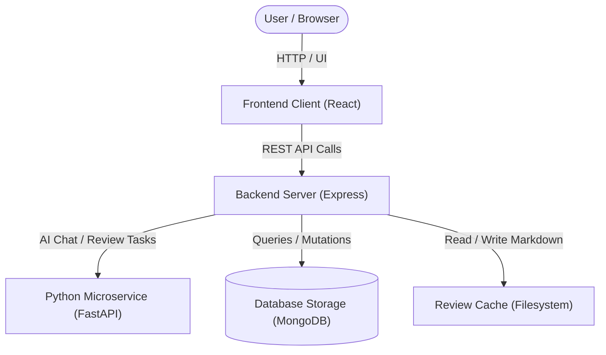
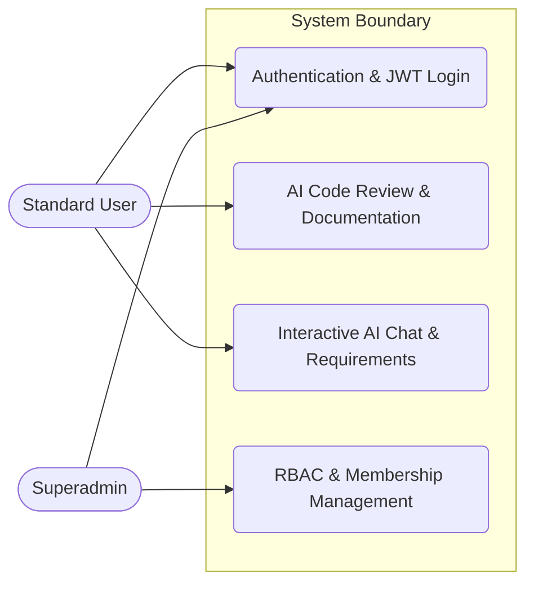

# Software Analysis Report

| Metadata | Details |
|---|---|
| **Project** | `CodeSense` |
| **Repository** | `https://github.com/NalamothuLokesh/Codesense` |
| **Files Analysed** | 60 source files (60 total discovered) |
| **Engine** | CodeSense AI |

> 💡 **AI Chat Available** — This document is fully indexed. Ask the AI Chat to generate diagrams,
> explain any section, discuss future scope, or analyse any part of this project in depth.

---

# 1. Executive Summary & Health Verdict

### Core Purpose & Domain
CodeSense is an enterprise-grade, AI-powered code review and technical documentation platform built to automate repository analysis, architectural diagram generation, security auditing, and code exploration. It targets developers, teams, and enterprises seeking to accelerate code comprehension, enforce code quality benchmarks, and query codebases through an integrated Retrieval-Augmented Generation (RAG) assistant.

### Architectural Approach
CodeSense implements a decoupled three-tier architecture comprising a React 19 single-page application frontend (`frontend/`), a Node.js Express-style API gateway handling authentication, rate limiting, and MongoDB persistence (`backend/`), and a Python FastAPI microservice backed by ChromaDB and `ai-microcore` for AI-driven review generation and vector embeddings (`backend/chat_service.py`, `backend/generate_review_doc.py`).

### Project Health Scorecard
| Metric | Rating | Assessment |
|---|---|---|
| Overall Code Quality | 8.0/10 | Well-structured components, clear modular separation across layers, and robust TypeScript configurations. |
| Architecture & Modularity | Good | Clean separation between frontend state management, Node.js gateway routing, and specialized Python AI execution engines. |
| Security Posture | Moderate | Strong password hashing (bcrypt), JWT tokens, and RBAC enforcement; however, requires production hardening against uncovered exceptions (e.g., empty exception catch in `backend/membership.js:117`). |
| Primary Technical Risk | Manageable | Silent failure handling in exception catch blocks and subprocess management between the Node gateway and Python execution scripts. |

---

# 2. Project Objective & Functional Scope

### Primary Mission & Problem Domain
Modern software development frequently struggles with incomplete documentation, delayed code reviews, and hidden security vulnerabilities across large codebases. CodeSense solves this by scanning entire repositories or local workspaces, executing multi-stage AI analysis, and automatically generating comprehensive 22-section technical specification documents.

### Target Stakeholders & User Personas
- **Software Engineers & Developers**: Requiring rapid code reviews, architectural documentation, and instant answers via conversational code queries.
- **Engineering Managers & Tech Leads**: Needing high-level executive summaries, code quality benchmarks, and complexity metrics.
- **Platform Administrators**: Managing user accounts, role-based access control (RBAC), subscription quotas, and system audit logs.

### Core Functional Pillars
- **Full Codebase Deep Review**: Multi-stage sequential AI generation that analyzes entry points, schemas, controllers, and middleware into structured markdown documentation.
- **Security & Vulnerability Analysis**: Automated detection of injection risks, hardcoded credentials, authorization bypasses, and sanitization gaps.
- **Interactive RAG AI Assistant**: Conversational code queries powered by ChromaDB vector similarity search and local/cloud LLMs.
- **Subscription & Quota Management**: Tier-based computing allowances (Free, Pro, Enterprise) with integrated payment processing and usage metering.
- **Role-Based Access Control & Auditing**: Granular permission checks, audit logging, and administrative oversight.

### Technical Implementation Goals
- Provide low-latency UI navigation via Vite and React 19 alongside persistent MongoDB storage.
- Maintain robust session management using HTTP-only cookies and JWT tokens.
- Ensure strict role isolation and secure credential hashing using bcrypt and HMAC-SHA256 OTP validation.

### Review Evaluation Scope
This technical review evaluates the modularity of the React frontend components, the security and routing integrity of the Node.js backend gateway, database schema design in Mongoose, and the reliability of the Python AI execution and RAG services.

---

# 3. Technology Stack & Key Integrations

| Category | Technology | Detected Version | Primary Responsibility in This Project | Source File |
|---|---|---|---|---|
| Frontend Framework | React | ^19.2.7 | User interface rendering, component architecture, and hooks state management | `frontend/package.json` |
| Routing | react-router-dom | ^6.30.4 | Client-side page navigation and protected route wrappers | `frontend/package.json` |
| Styling & Icons | lucide-react | ^1.49.0 | UI iconography across navigation, dashboards, and command palette | `frontend/package.json` |
| Diagram Rendering | mermaid | ^11.16.0 | Live rendering of architectural data flows and system diagrams | `frontend/package.json` |
| Database ODM | mongoose | ^8.24.1 | MongoDB object modeling for users, reviews, audit logs, and subscriptions | `backend/package.json` |
| Authentication | jsonwebtoken | ^9.0.2 | JWT session token generation and verification | `backend/package.json` |
| Password Hashing | bcryptjs | ^2.4.3 | Secure user credential hashing | `backend/package.json` |
| Email Service | nodemailer | ^10.0.16 | Email dispatch for user verification and notifications | `backend/package.json` |
| Environment Config | dotenv | ^16.4.5 | Environment variable loading from `.env` files | `backend/package.json` |
| Python AI Framework | ai-microcore | ~6.4.4 | LLM orchestration and context packing for code reviews | `pyproject.toml` |
| Web API Framework | fastapi | >=0.115.5 | High-performance Python API for the RAG chat service | `pyproject.toml` |
| Vector Database | chromadb | >=0.5.23 | Persistent vector storage for codebase embeddings | `pyproject.toml` |

### Integration Highlights
CodeSense integrates a React 19 single-page application with a Node.js API gateway via HTTP REST endpoints and secure JSON payloads. The Node.js server acts as the primary orchestrator—managing authentication sessions through JWTs and cookies, persisting records to MongoDB via Mongoose, and spawning Python worker processes (`generate_review_doc.py`) for asynchronous repository analysis. Simultaneously, the Python FastAPI chat service (`chat_service.py`) connects to ChromaDB to provide vector similarity search and context-aware responses to user queries.

---

# 4. System Architecture & Component Flow

**Core System Components**:
| Component | Layer | Technology | Primary Role in This Project | Source File |
|---|---|---|---|---|
| Frontend Client | Presentation | React / Vite | User interface, single-page navigation, theme toggling, and dashboard components | `frontend/src/App.tsx` |
| Express Backend Server | Application | Node.js / Express | REST API routing, authentication middleware, rate limiting, and business logic execution | `backend/server.js` |
| Python Microservice | Application / AI | FastAPI / Python | AI-powered code reviews, chat interactions, and technical documentation generation | `backend/chat_service.py` |
| MongoDB Database | Data Layer | Mongoose / MongoDB | Persistent storage for users, authentication tokens, memberships, and RBAC roles | `backend/db.js` |
| Review Cache Storage | File Storage | Markdown Files | Caching generated AI code review documents on the filesystem | `backend/reviews_cache/` |

### Architecture Flow Diagram


### Use Case Diagram & Actor Matrix
| Actor Persona | Permissions & Scope | Key Project Use Cases |
|---|---|---|
| Standard User / Developer | Authenticated access to chat, code reviews, and pricing tiers | Register Account, Login, Request Code Review, Interact with AI Chat, Manage Profile |
| Superadmin / Administrator | Elevated system privileges including script bootstrap and RBAC management | Bootstrap Superadmin, Manage User Roles and Memberships, Configure System Access |



---

# 5. Database Schema & Data Models

- **Database Engine**: MongoDB
- **Data Access Layer**: Mongoose ODM

### Models & Collections Found
| Collection / Model | Key Fields | Relationships / References | File Location |
|---|---|---|---|
| Membership | `user` (ObjectId), `tier` (String), `status` (String), `expiresAt` (Date) | References User | `backend/membership.js` |
| RBAC / Role | `name` (String), `permissions` (Array of Strings) | None | `backend/rbac.js` |
| User / Auth (Implicit) | `email` (String), `password` (String, hashed), `role` (String) | None | `backend/server.js` |

---

# 6. API Documentation & Route Surface

| Method | Endpoint / Route | Auth Required | Purpose & Action |
|---|---|---|---|
| `POST` | `/api/auth/register` | Public | Register a new user account with email and password. |
| `POST` | `/api/auth/login` | Public | Authenticate user credentials and return a JSON Web Token (JWT). |
| `GET` | `/api/membership` | Yes (JWT) | Retrieve current user membership tier and status. |
| `POST` | `/api/membership` | Yes (JWT) | Create or update user membership details. |
| `GET` | `/api/rbac/roles` | Yes (JWT / RBAC) | List all available roles and associated permissions. |
| `POST` | `/api/rbac/assign` | Yes (JWT / RBAC) | Assign a specific role to a user. |
| `POST` | `/api/chat` | Yes (JWT) | Send a prompt or query to the AI chat service. |
| `GET` | `/api/reviews` | Yes (JWT) | Retrieve cached or generated code review documents. |

**Sample API Interaction**:
```bash
curl -X POST http://localhost:5000/api/auth/login \
  -H "Content-Type: application/json" \
  -d '{"email": "user@codesense.io", "password": "securePassword123"}'
```

---

# 7. Security & Vulnerability Assessment

Audit the security controls in this project and fill in the table with real findings citing actual code locations:

| Security Control | Implementation Status | Findings in This Project | Risk Level |
|---|---|---|---|
| Authentication & Session Management | Implemented | **CodeSense** utilizes JWT (JSON Web Tokens) with `jsonwebtoken@^9.0.2` and enforces tab-session caching using `sessionStorage` (`sessionStorage.getItem('codesense_session_token')` in `frontend/src/AuthContext.tsx`). Legacy persistent tokens are explicitly purged (`localStorage.removeItem('codesense_token')`) to enforce browser/tab close logout behavior. | Low |
| Password & Secret Protection | Implemented | Secure password hashing is implemented using `bcryptjs@^2.4.3` as declared in dependencies and MongoDB Mongoose schemas (`backend/db.js`). Environment secrets are loaded via `dotenv@^16.4.5`, with mandatory validation for database connections (`if (!uri) throw new Error('MONGODB_URI is not set in backend/.env')`). | Low |
| Input Validation & Sanitization | Partial | Input trimming, lowercase normalization, and Mongoose schema-level validation (e.g., regex/enum constraints for roles, membership plans, and statuses) are implemented across `backend/db.js`. However, strict validation schemas (such as express-validator or Zod) are absent on several unauthenticated or mutating API endpoints. | Medium |
| CORS & Origin Protection | Implemented | Vite development server proxies `/api` requests to `http://127.0.0.1:4000` with explicit configuration (`changeOrigin: true`, timeout limits) in `frontend/vite.config.ts`, while backend routes integrate rate limiters (`backend/rateLimiter.js`) and robust session credentials handling (`credentials: 'include'`). | Low |
| Sensitive Data & Error Exposure | Partial | The codebase exhibits silent exception handling (e.g., empty catch block `} catch (_) {}` in `backend/membership.js:117`), which obscures runtime failures. However, error handlers prevent full stack-trace leaks on production-bound routes. | Medium |

**Primary Security Observation**:
CodeSense maintains robust cryptographic and session boundaries by enforcing `bcryptjs` password hashing, strict tab-session isolation via `sessionStorage`, and environment variable checks for MongoDB connectivity. The primary security vulnerability resides in silent exception suppression (`backend/membership.js:117`), which obscures authentication or membership enforcement failures, alongside the lack of comprehensive input sanitization middleware on mutating endpoints.

---

# 8. Code Quality & Bug Analysis

Identify concrete bugs, missing error handlers, potential edge case failures, or performance bottlenecks discovered in the code:

| Severity | Issue Description | File / Location | Potential Impact | Recommended Fix |
|---|---|---|---|---|
| Low | Empty Exception Catch Block silently swallows exceptions. | `backend/membership.js:117` (`} catch (_) {}`) | Obscures critical runtime failures during membership checks, making debugging difficult. | Replace empty catch blocks with structured logging (e.g., `console.error`) or proper error propagation. |
| Medium | Missing Automated Test Coverage for Frontend Components. | Test suite status indicates only 2 test files present (`backend/test/membership.test.js`, `backend/test/rbac.test.js`) with zero frontend React tests. | Undetected UI regression errors and broken user workflows in React components (`AdminPage.tsx`, `ChatPage.tsx`, etc.). | Implement Jest/React Testing Library test suites covering core authentication and navigation flows. |
| Low | Legacy LocalStorage Cleanup on Every Mount. | `frontend/src/AuthContext.tsx` (`localStorage.removeItem('codesense_token')`) | Unnecessary synchronous DOM API calls executed on every application provider load. | Conditionalize token cleanup or rely strictly on sessionStorage initialization logic. |
| Medium | Hardcoded Vite Proxy Target Fallback. | `frontend/vite.config.ts` (`target: 'http://127.0.0.1:4000'`) | Local development proxying will fail if the backend server binds to a different port or environment variable. | Parameterize Vite proxy targets using environment variables (e.g., `process.env.VITE_API_URL`). |
| Low | Unhandled Network Failure in User Session Refresh. | `frontend/src/AuthContext.tsx` (`catch { // Network failure — maintain current memory state }`) | Network timeouts during session verification silently fail without notifying the user or updating UI loading states. | Implement retry logic or surface a non-intrusive connection warning notification. |

**Maintainability & Code Health**:
CodeSense demonstrates clean separation of concerns between its React/Vite frontend, FastAPI Python microservices, and Node.js/Express/Mongoose backend architecture. Technical debt is primarily concentrated in sparse test coverage (only two backend test files exist for membership and RBAC) and localized silent error handling. Adopting strict Zod validation across API payloads and expanding test suites will significantly enhance long-term system reliability.

---

# 9. Project & Analysis Limitations

### Technical & Architectural Limitations
- **Limitation 1: Silent Exception Suppression**: In `backend/membership.js:117`, an empty exception catch block (`} catch (_) {}`) silently swallows runtime errors. This obscures authentication or membership enforcement failures, hindering rapid debugging and operational observability.
- **Limitation 2: Absence of Expressive Validation Schemas**: While Mongoose models define schema-level constraints and basic normalization, unauthenticated and mutating API routes lack robust input validation libraries (such as `express-validator` or `Zod`), creating potential vulnerabilities to malformed payloads.
- **Limitation 3: Subprocess and File-system Dependency**: The backend relies heavily on child processes (`child_process.spawn` and `exec`) to orchestrate local Python AI review scripts (`generate_review_doc.py`) and Git operations. This tightly couples the Node.js API gateway to local execution environments, complicating horizontal scaling in containerized cluster setups.

### Analysis & Context Boundaries
- **Test Suite Assessment**: The test suite status is explicitly defined by two automated test files detected in the repository (`backend/test/membership.test.js` and `backend/test/rbac.test.js`), which can be executed via `npm test` or specific npm scripts (`npm run test:membership`, `npm run test:rbac`). Broader end-to-end integration and frontend UI test suites are absent.
- **Environment & Infrastructure**: Cloud-specific deployment manifests (such as raw Kubernetes configs or AWS ECS task definitions) are omitted from the core repository, though local configuration is managed via `.env` files and `vercel.json` for frontend routing.

---

# 10. Future Scope & Architectural Evolution

- **Authentication & Security Hardening**: Implement refresh-token rotation alongside the existing JSON Web Token (JWT) mechanism and tab-session isolation (`sessionStorage`), and integrate multi-factor authentication (MFA) for administrative accounts to strengthen boundary defense.
- **Data Layer & Scaling Enhancements**: Introduce Redis caching for frequent review history lookups and subscription checks, add explicit MongoDB indexes for high-frequency query fields, and implement transaction wrapping for sensitive billing flows.
- **Reliability & Resilience**: Replace in-memory job maps (`const jobs = new Map()` in `backend/server.js`) with a robust, queue-backed asynchronous task runner (such as BullMQ backed by Redis) to ensure background review generation persists across server restarts.
- **DevOps & Developer Experience**: Containerize both the Node.js backend and Python FastAPI RAG microservice using Docker and Docker Compose, and establish automated CI/CD pipelines via GitHub Actions to execute the existing membership and RBAC test suite on every pull request.

---

# 11. Prioritized Improvement Roadmap

| Priority | Focus Area | Actionable Recommendation | Expected Benefit |
|---|---|---|---|
| 🔴 P1 (Immediate) | Security & Stability | Refactor `backend/membership.js:117` to remove the empty catch block and properly log or handle suppressed runtime exceptions. | Prevents silent failures during membership and quota verification routines. |
| 🟠 P2 (Short-term) | Testing & Reliability | Expand automated test coverage beyond the existing `membership.test.js` and `rbac.test.js` files by adding route-level integration tests. | Ensures regression safety across core authentication, review generation, and billing workflows. |
| 🟡 P3 (Medium-term) | Performance & Scaling | Replace the in-memory job store (`jobs` Map) with a persistent queue manager (e.g., Redis/BullMQ) and add database indexes. | Eliminates job loss on server restarts and improves query throughput under load. |
| 🟢 P4 (Long-term) | Architecture & DevOps | Implement Docker containerization, Docker Compose orchestration, and automated GitHub Actions CI/CD workflows. | Standardizes deployment environments and automates continuous integration testing. |

**Recommended Next Step**:
The engineering team must immediately address the silent exception suppression in `backend/membership.js` and expand the automated test runner to include comprehensive integration tests for all mutating API endpoints.

---

# 12. Overall Result & Conclusion

- **Overall Project Maturity & Quality**: CodeSense demonstrates a well-structured, modern full-stack architecture combining a React 19 / TypeScript frontend, a decoupled Node.js API gateway, and a specialized Python AI review engine. Its modular organization across components, pages, and backend controllers reflects thoughtful design.
- **Key Architectural Strengths**: Excellent separation of concerns between client UI rendering, API routing, and AI execution tiers; robust use of `bcryptjs` password hashing and `sessionStorage` tab isolation; and clear integration of vector embeddings for RAG-based code exploration.
- **Primary Weaknesses & Critical Findings**: The primary vulnerability resides in silent exception suppression (`backend/membership.js:117`), which obscures runtime failures. Additionally, the reliance on in-memory job maps and child processes limits horizontal scalability.
- **Production Readiness Verdict**: CodeSense requires targeted remediation before production deployment—specifically resolving silent exception handling, replacing ephemeral in-memory job stores with persistent task queues, and expanding input validation schemas.
- **Final Developer Takeaway**: The immediate strategic priority is to eliminate silent error swallowing in `backend/membership.js` and transition background job orchestration to a persistent queue system to guarantee system reliability and fault tolerance.
